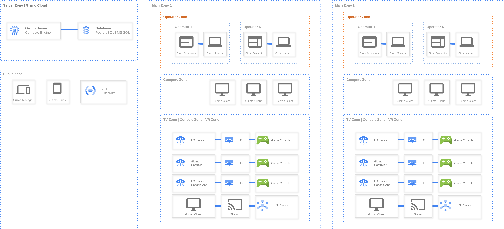

Gizmo is not one program but several apps that work together. The main component is **Gizmo Server**: all the others connect to it.

{width=7048px height=3208px}

## <icon code="layers" /> Main components

| Component | What it does | Where it runs | Who works with it |
|---|---|---|---|
| [Gizmo Server](./gizmo-server.md) | Processes operations, stores customer data and manages the other components | The club server | The administrator, during installation and maintenance |
| [Gizmo Manager](./gizmo-manager.md) | Floor service, sales, club settings, reports | A browser on any device | Operators and administrators |
| [Gizmo Client](./gizmo-client.md) | The shell where the guest logs in, launches games and buys time | The club's gaming PCs | Guests |
| [Gizmo Companion](./gizmo-companion/_index.md) | Sends commands to POS and retail hardware | The PC used for sales | Runs in the background |

## <icon code="share-2" /> How the components are connected

- **Gizmo Server** works together with a **database** (PostgreSQL or Microsoft SQL Server) that stores all club information: guest profiles, balances, prices, purchase history.
- **Gizmo Manager** and all gaming PCs with **Gizmo Client** connect to Gizmo Server over the club network.
- **Gizmo Companion** is installed on every point of sale, connects to the server and is linked to a register in Gizmo Manager. Without it, card payments and receipt printing are not available.

## <icon code="hourglass" /> In development

- Gizmo Manager Mobile
- Gizmo Clubs
- Gizmo Controller App
- Gizmo Anywhere
