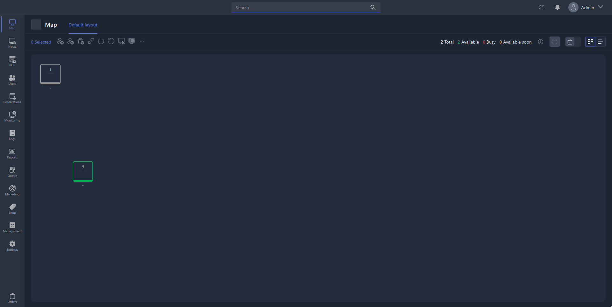

**Gizmo Manager** is the app where most of the work with the Gizmo system is done, and the club operator's main workspace.

## <icon code="info" /> In short

| **Where it runs** | In a browser on any device: it opens at the server's address |
|---|---|
| **Who uses it** | Club operators and administrators |
| **What it needs** | An installed [Gizmo Server](./gizmo-server.md) and an operator account |

> [!NOTE]
>
> There is no full desktop app for Gizmo V3 -- it uses a web architecture that lets you manage the club from any device with a browser. You can install the Gizmo Manager page from the browser as an app -- see the [Gizmo Manager as an App](./../../tutorials/gizmomanager-as-an-app.md) guide.

{width=1920px height=965px}

## <icon code="list-checks" /> What you can do

- **Serve the floor** -- seat guests, track seat occupancy and time on the map, put guests in the waiting line, reserve seats.
- **Sell products and services** -- ring up time and products at the register, accept payment, manage deposits.
- **Set up the club** -- computers and endpoints, the shop's range, promotions and discounts.
- **Work with reports** -- analyze data in reports, track errors in the log, keep stock records in the warehouse.

## <icon code="book-open" /> Learn more

- [Gizmo Manager](./../../usage/gizmo-manager/_index.md) -- a description of all sections and the app interface.
- [Login screen](./../../usage/gizmo-manager/login-screen.md) -- operator login and authorization.
- [Operator quick guide](./../../tutorials/operations/operator-guide.md) -- a whole shift at the front desk, step by step.
