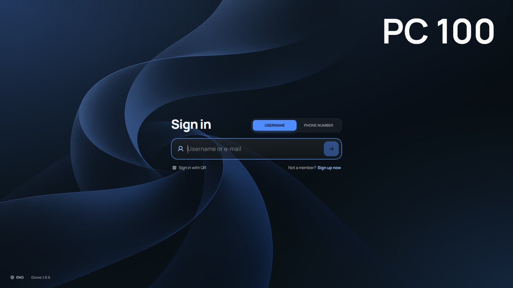
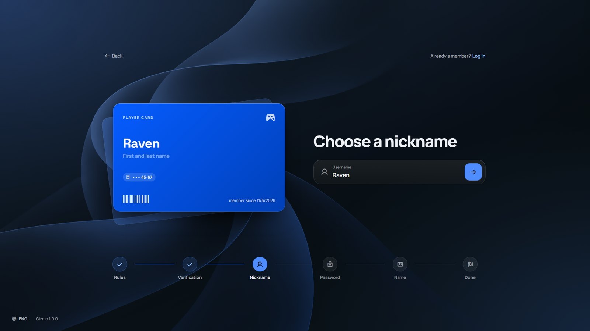
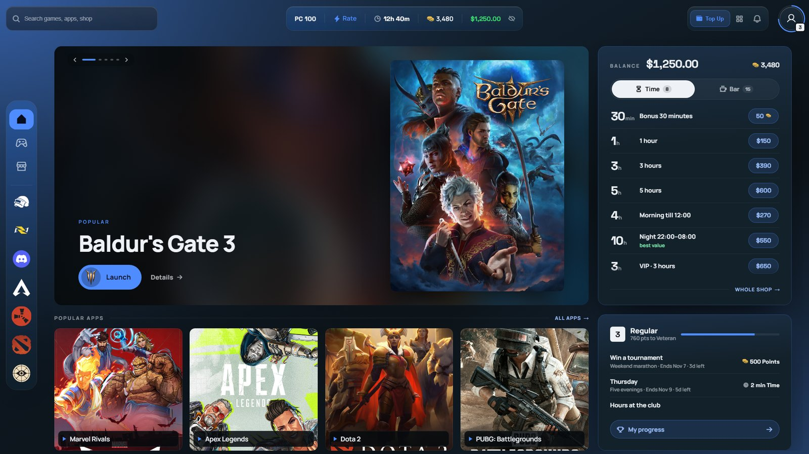
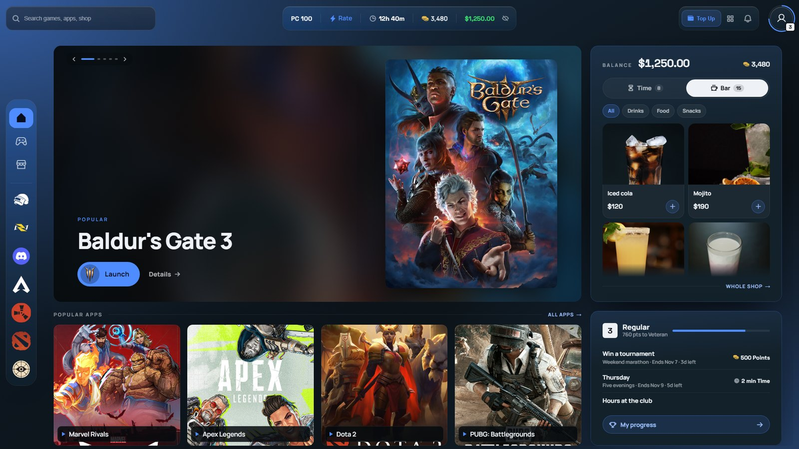
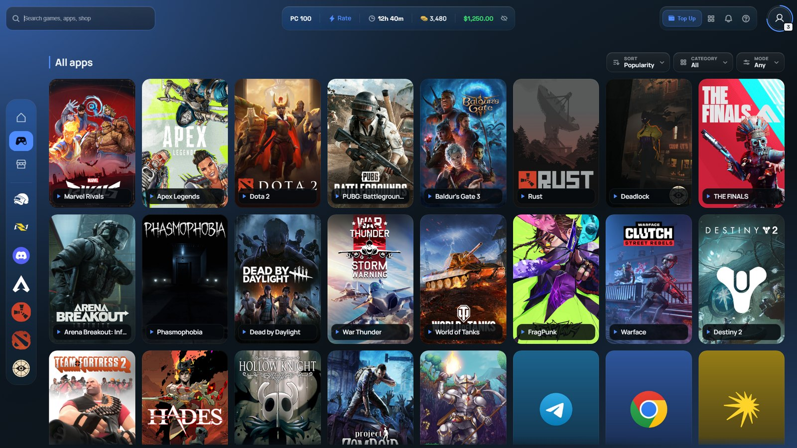
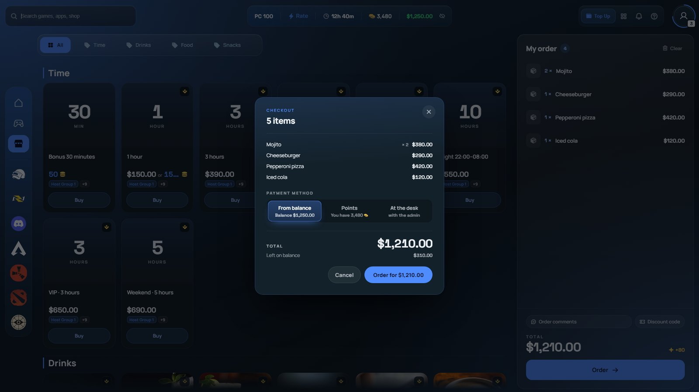
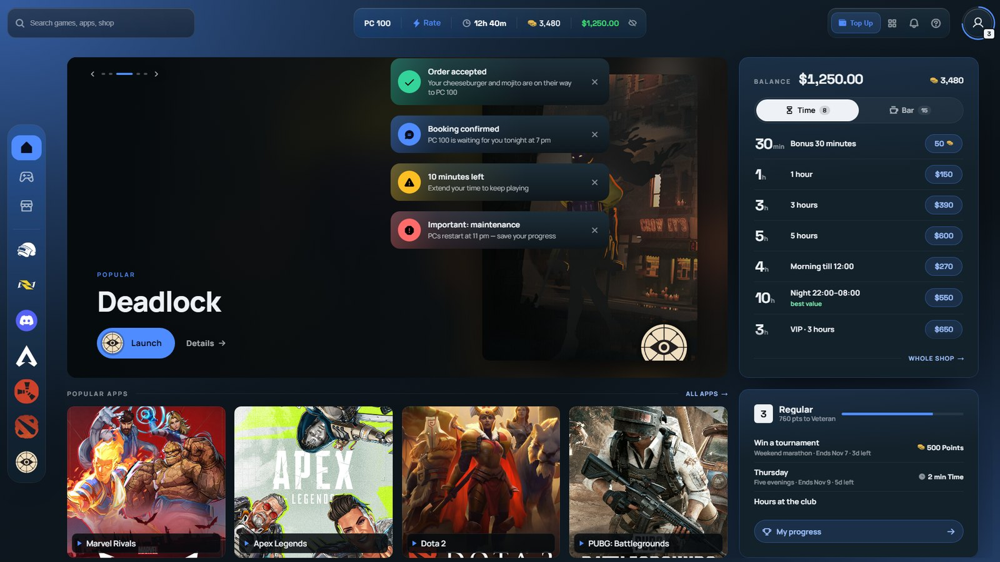
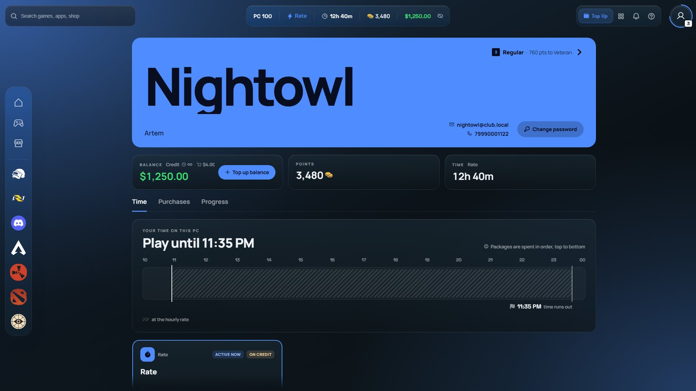
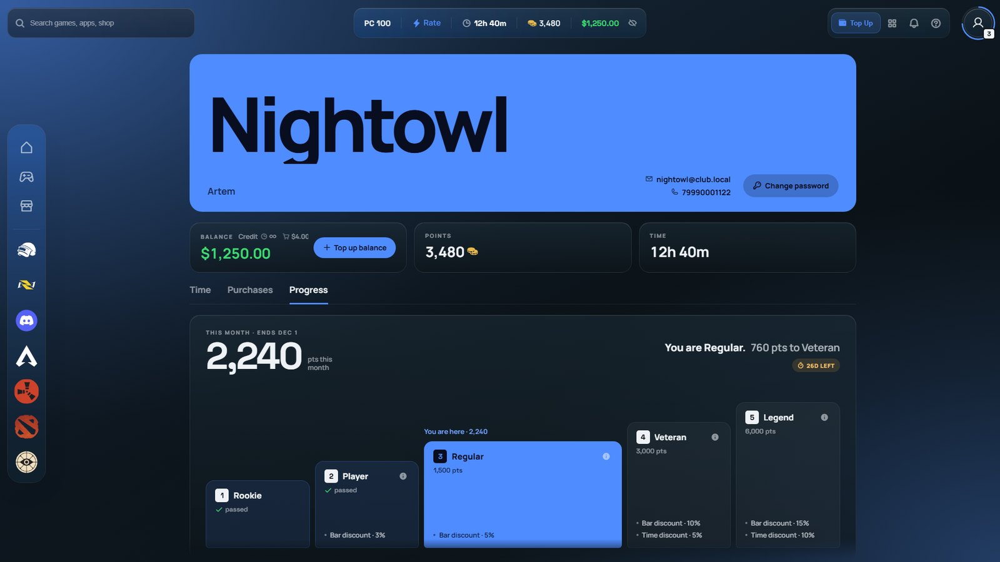
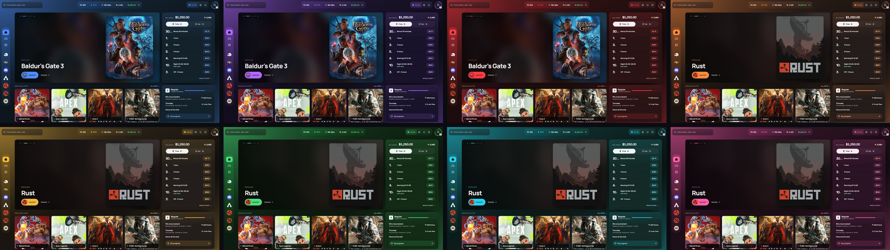

# The Grafit shell

Grafit is a new client shell for Gizmo V3. We have always believed a shell should be more than a window you pass through on the way to a game — it should be part of the **club's atmosphere**. So we **rebuilt the shell from the ground up** around what esports arenas actually need.

The article has two parts:

**Shell overview** — what your guests will see and how each section works.

**Look and feel** — how to make the shell truly yours by changing the accent colour and more.

---

## Part 1. Shell overview

### 1.1 Sign-in



Guests sign in whichever way suits them: with a username, a phone number or a QR code. The password comes as a second step — the shell greets the guest by name, and if someone else has sat down at the PC, it is easy to switch.

### 1.2 Sign-up



New guests can sign up on their own, right at the PC, so your staff don't have to step away. They accept the club rules, verify their account in the way you have chosen, and pick a nickname and a password.
As they fill in the fields, their player card comes together beside the form. A small touch, but sign-up stops feeling like a boring form.

### 1.3 Home



Home is the club's shop window. Popular games are shown large on the left; everything to do with sales is on the right, including the balance, points and time packages that guests can buy right here. Along the bottom are the most-played apps and the guest's progress in the loyalty program.

### 1.4 Bar



The bar lives right on Home, in a tab next to the time packages. Guests see drinks and food with photos and prices and add them to the cart with a single tap — the order is literally two taps away.

### 1.5 Library



All of the club's games and apps in one place, with large covers. Category filters help guests find what they want quickly.

### 1.6 Checkout



Guests pay the way that suits them: from their balance, with points, or at the front desk. If the balance falls short, the rest can be paid another way, and the shell shows right away how much is needed.

### 1.7 Notifications



### 1.8 Profile and progress



In their profile, guests have everything about themselves at hand: balance, points, time left and purchase history.



On the Progress tab, guests see their level, challenges and achievements. It is a good reason to come back to your club again and again.

---

## Part 2. Look and feel

The look of the shell is set up in Gizmo Manager, in a skin profile.

### 2.1 Skin profile

A profile is a set of appearance settings for a host group. You can make different profiles for different groups — for example, one colour for the VIP room and another for the main hall.

1. Open **Settings → Client → Skins → Default Skin** and choose Grafit.
2. Create a skin profile — or open an existing one.
3. Set what you need (see section 2.2) and save the profile.
4. Open **Hosts → Host Groups**, choose a group and set this profile in the **Theme Profile** field. Also make sure **Theme** is set to Grafit.
5. Save the changes and restart Gizmo Client on the PCs.

Every field of the profile is described in the article "Skin profile card".

### 2.2 Colour



Grafit comes with 8 ready-made colours; blue is the default. Changing the colour repaints the whole shell at once, including buttons, accents and the background — so everything stays in harmony.

In the profile card, find the **Others** block and paste this line into the **Custom CSS** field:

```css
:root { --giz-palette: purple; }
```

Instead of `purple`, you can use any of these:

| Value | Colour |
|---|---|
| `blue` | blue (default) |
| `purple` | purple |
| `red` | red |
| `orange` | orange |
| `amber` | amber |
| `green` | green |
| `teal` | teal |
| `pink` | pink |

Want the exact colour of your club's logo? Enter its code — the shell will work out all the shades it needs on its own:

```css
:root { --giz-palette: #e11d48; }
```

Save the profile and restart Gizmo Client on the PCs.

Done — the shell now fits the style of your arena even better!
