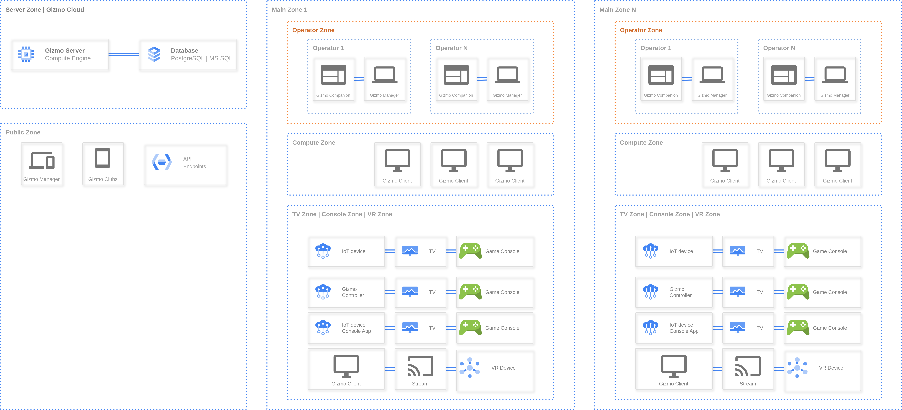

Gizmo -- не одна программа, а несколько приложений, которые работают вместе. Главный компонент -- **Gizmo Server**: к нему подключаются все остальные.

{width=7048px height=3208px}

## <icon code="layers" /> Основные компоненты

| Компонент | Что делает | Где работает | Кто с ним работает |
|---|---|---|---|
| [Gizmo Server](./gizmo-server.md) | Обрабатывает операции, хранит данные о клиентах и управляет остальными компонентами | Сервер клуба | Администратор при установке и обслуживании |
| [Gizmo Manager](./gizmo-manager.md) | Обслуживание зала, продажи, настройка клуба, отчёты | Браузер на любом устройстве | Операторы и администраторы |
| [Gizmo Client](./gizmo-client.md) | Оболочка, в которой гость входит в систему, запускает игры и покупает время | Игровые пк клуба | Гости |
| [Gizmo Companion](./gizmo-companion/_index.md) | Передаёт команды кассовому и торговому оборудованию | Пк, с которого ведутся продажи | Работает в фоне |

## <icon code="share-2" /> Как компоненты связаны

-  **Gizmo Server** работает вместе с **базой данных** (PostgreSQL или Microsoft SQL Server), в которой хранится вся информация клуба: профили гостей, балансы, цены, история покупок.

-  **Gizmo Manager** и все игровые пк с **Gizmo Client** подключаются к Gizmo Server по сети клуба.

-  **Gizmo Companion** устанавливается на каждую точку продаж, подключается к серверу и привязывается к кассе в Gizmo Manager. Без него проведение платежей и печать чеков недоступны.

## <icon code="hourglass" /> В разработке

-  Gizmo Manager Mobile

-  Gizmo Clubs

-  Gizmo Controller App

-  Gizmo Anywere
