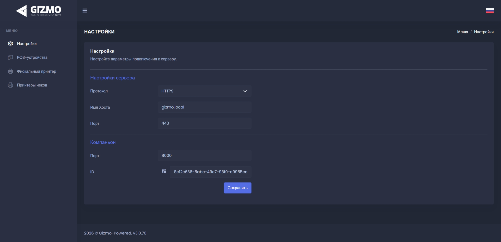

**Gizmo Companion** -- приложение-связующее звено (мост), которое объединяет кассовое и торговое оборудование клуба с сервером Gizmo. Пк с установленным Companion становится точкой продаж.

## <icon code="info" /> Кратко

| | |
|---|---|
| **Где работает** | На каждом пк, с которого ведутся продажи (обычно это пк администратора) |
| **Кто использует** | Работает в фоне: оператор продаёт в Gizmo Manager, а Companion передаёт команды оборудованию |
| **Что нужно для работы** | Подключение к [Gizmo Server](./../gizmo-server.md) и привязка к кассе в Gizmo Manager |

## <icon code="plug" /> Зачем нужен Gizmo Companion

Gizmo Companion отвечает за взаимодействие сервера Gizmo с кассовым и торговым оборудованием клуба:

-  **фискальные накопители и кассовые аппараты** -- для печати чеков и передачи данных в налоговую;

-  **эквайринговые терминалы** -- для приёма оплаты картами;

-  **POS-периферия** -- денежные ящики, сканеры штрихкодов, считыватели смарт-карт и чековые принтеры.

> [!WARNING]
>
> Без установленного и настроенного Gizmo Companion система Gizmo не сможет передавать команды на фискальный принтер, а значит, проведение платежей и печать чеков будут недоступны.

## <icon code="book-open" /> Подробнее

-  [«Как подключить Companion и настроить кассу»](./../../../tutorials/sales/register/companion-and-register.md) -- установка и привязка к кассе по шагам.

-  [«Компаньоны»](./../../../configure/server/companions/_index.md) -- настройки Companion в Gizmo Manager.
