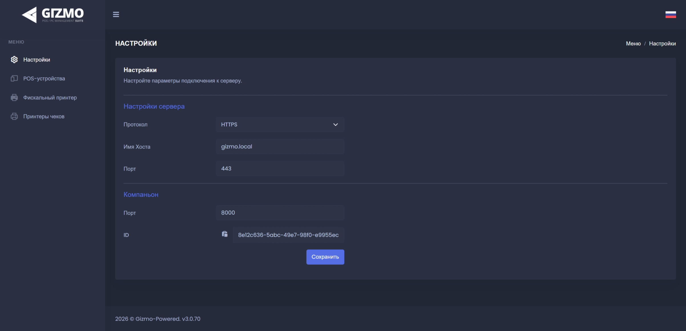

**Gizmo Companion** -- это приложение-связующее звено (мост), которое объединяет всё кассовое и торговое оборудование вашего клуба с сервером управления Gizmo.

Оно отвечает за взаимодействие сервера Gizmo с такими устройствами, как:

-  Фискальные накопители и кассовые аппараты (для печати чеков и передачи данных в налоговую);

-  Эквайринговые терминалы (для приёма оплаты картами);

-  POS-периферия: денежные ящики, сканеры штрихкодов, считыватели смарт-карт и чековые принтеры.

> **Важно:** Без установленного и настроенного Gizmo Companion система Gizmo не сможет передавать команды на фискальный принтер, а значит, проведение платежей и печать чеков будут недоступны.
