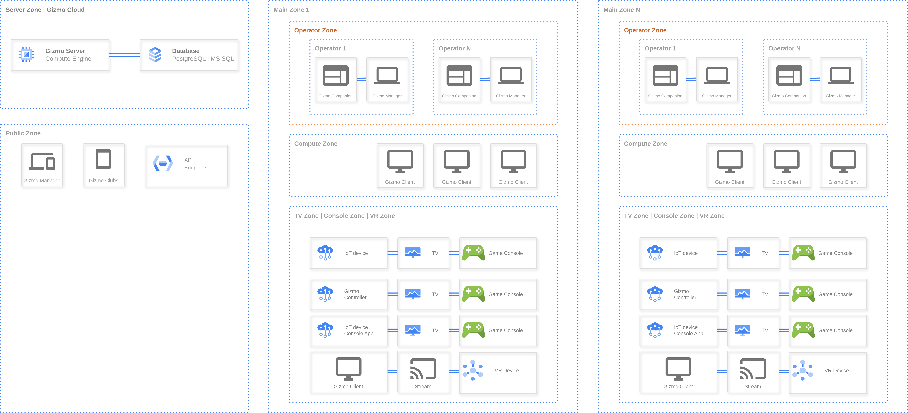

**Gizmo Server** -- главный компонент **Gizmo**.

## Архитектура Gizmo

{width=7048px height=3208px}

### Версии Gizmo Server

Gizmo Server существует в двух вариантах:

-  Self-hosted версия -- сервер разворачивается на вашем собственном оборудовании.

-  Облачная версия (в разработке) -- подробнее в статье [«Облачная версия»](./../../instalation/gizmo/cloud.md).

Self-hosted версию можно установить тремя способами:

-  Gizmo Server для Windows

-  Gizmo Server для Linux

-  Gizmo Server для Docker

### Базы данных

Self-hosted версия работает с одной из двух баз данных:

-  PostgreSQL (версии 15 и выше)

-  Microsoft SQL Server (версии 2017 и выше)

> [!NOTE]
> 
> В Self-hosted версии базу данных можно установить вместе с Gizmo Server (на том же сервере) или отдельно от него -- в том числе во внешней сети.

### Минимальные системные требования к серверу для Self-hosted версии

<tabs>

<tab name="Gizmo Server">

**Windows**

-  **Процессор** -- Intel Core i3 8-го поколения.
-  **Память** -- 8 ГБ DDR4.
-  **Диск** -- 1 ГБ SSD.

**Linux**

-  **Процессор** -- Intel Core i3 8-го поколения.
-  **Память** -- 4 ГБ DDR4.
-  **Диск** -- 1 ГБ SSD.

**Docker** (версия для Linux)

-  **Процессор** -- Intel Core i3 8-го поколения.
-  **Память** -- 2 ГБ DDR4.
-  **Диск** -- 1 ГБ SSD.

</tab>

<tab name="База данных">

**Windows**

-  **Процессор** -- Intel Core i3 8-го поколения.
-  **Память** -- 8 ГБ DDR4.
-  **Диск** -- 30 ГБ SSD NVMe.

**Linux**

-  **Процессор** -- Intel Core i3 8-го поколения.
-  **Память** -- 8 ГБ DDR4.
-  **Диск** -- 30 ГБ SSD NVMe.

**Docker** (версия для Linux)

-  **Процессор** -- Intel Core i3 8-го поколения.
-  **Память** -- 4 ГБ DDR4.
-  **Диск** -- 30 ГБ SSD NVMe.

</tab>

<tab name="Gizmo Server и база данных">

**Windows**

-  **Процессор** -- Intel Core i3 8-го поколения.
-  **Память** -- 16 ГБ DDR4.
-  **Диск** -- 40 ГБ SSD NVMe.

**Linux**

-  **Процессор** -- Intel Core i3 8-го поколения.
-  **Память** -- 8 ГБ DDR4.
-  **Диск** -- 40 ГБ SSD NVMe.

**Docker** (версия для Linux)

-  **Процессор** -- Intel Core i3 8-го поколения.
-  **Память** -- 4--8 ГБ DDR4 (для 50+ подключённых клиентов рекомендуем 8 ГБ).
-  **Диск** -- 40 ГБ SSD NVMe.

</tab>

</tabs>
