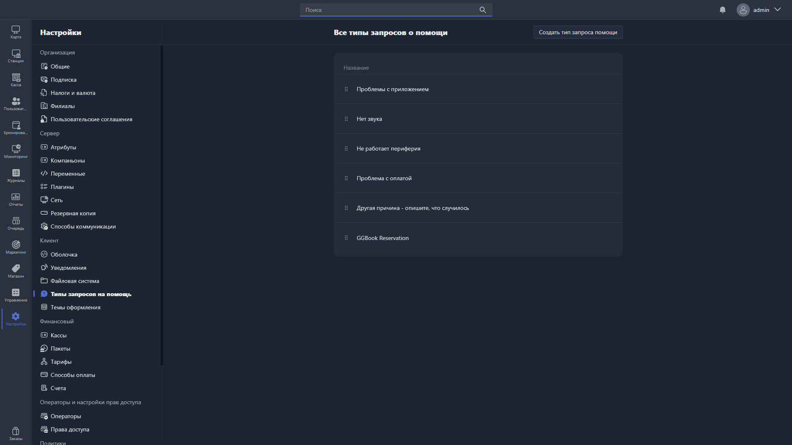

{width=1919px height=1079px}

Здесь настраиваются типы запросов о помощи, которые пользователь может отправить оператору через интерфейс Gizmo Client.

Функция включается автоматически, как только создан хотя бы один тип запроса: в Gizmo Client появится значок, через который гость отправляет оператору сообщение -- например, о проблеме с игрой или устройством. Запрос появляется в Gizmo Manager на вкладке **Запросы** в уведомлениях -- см. статью [«Уведомления»](./../../usage/gizmo-manager/interface/notifications.md). Оператор принимает или отклоняет запрос; когда оператор примет запрос, гость получит уведомление на своём пк. Чтобы оператор не пропустил запрос, включите для него звуковое уведомление в **Настройки -> Другое -> Центр действий** -- см. статью [«Центр действий»](./../others/action-center.md).

В списке отображаются все созданные типы запросов. Порядок их отображения можно изменить, перетаскивая элементы за иконку перетаскивания <icon code="grip-vertical" /> слева от названия.

Чтобы создать новый тип запроса, нажмите <cmd text="Создать тип запроса помощи"/> в правом углу страницы.

## Создание типа запроса

При создании нового типа запроса нужно заполнить поле:

-  **Название** -- наименование типа запроса, которое будет отображаться пользователю в Gizmo Client. Поле обязательно для заполнения.
