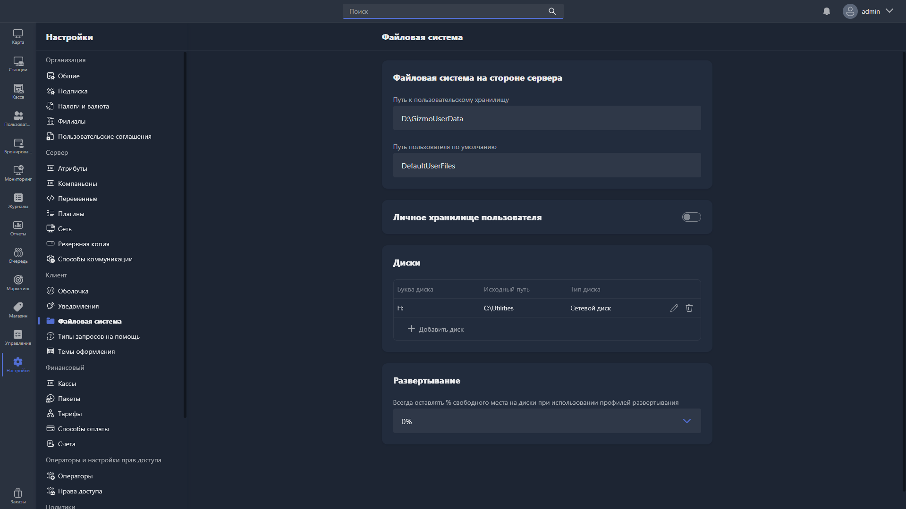

{width=1919px height=1079px}

В этом разделе настраивается файловая система на стороне сервера, личное хранилище пользователей, а также виртуальные диски и параметры развёртывания файлов на хостах.

## Файловая система на стороне сервера

-  **Путь к пользовательскому хранилищу** -- путь к директории на сервере, в которой хранятся личные файлы пользователей.

-  **Путь пользователя по умолчанию** -- путь к директории, которая используется как папка по умолчанию для новых пользователей при первом входе.

## Личное хранилище пользователя

При включении этой опции каждый пользователь получает личное хранилище файлов, доступное ему при входе на любой хост.

## Диски

Здесь настраиваются виртуальные диски, которые монтируются на хостах.

Для каждого диска указываются параметры:

-  **Буква диска** -- буква, под которой диск отображается в системе на хосте.

-  **Исходный путь** -- путь к директории на сервере, которая будет смонтирована как диск.

-  **Тип диска** -- тип монтирования виртуального диска.

Чтобы добавить диск, нажмите <cmd text="Добавить диск"/>. Чтобы удалить диск, используйте иконку корзины напротив записи.

### Типы дисков

-  **Виртуальный диск** -- собственный механизм Gizmo: папка подключается на клиентском пк как обычный диск Windows. С **прямым доступом** клиент читает файлы из источника сам -- источником может быть его локальная папка или общая сетевая папка, и у клиента должны быть права на неё. Без прямого доступа файлы передаёт Gizmo Server -- источник должен быть доступен серверу (например, его локальная папка). **Только чтение** запрещает изменять и удалять файлы источника. Учётные данные для доступа к источнику задаются только вместе с прямым доступом.

-  **Виртуальная папка** -- то же самое, но источник подключается не как диск, а как папка на клиентском пк. Папки может не быть на клиенте, а если она есть, то должна быть пустой. Диск, на котором создаётся папка, должен существовать.

-  **Сетевой диск** -- стандартное подключение сетевого диска Windows. Клиенты всегда обращаются к общей папке напрямую; при необходимости укажите учётные данные.

**Какой тип выбрать:**

| Задача | Тип |
|---|---|
| Раздать гостям папку с сервера (например, видео или образы) только для чтения | **Виртуальный диск** без прямого доступа, с **Только чтение**. Не создаёт общих папок Windows и не упирается в ограничение 20 подключений |
| Связать папку на клиенте с общей папкой на сервере (например, папку загрузок) | **Виртуальная папка** без **Только чтение**; папка на клиентах должна быть пустой |
| Подключить уже настроенную общую папку на файловом сервере или NAS | **Виртуальный диск** с прямым доступом или **Сетевой диск**, при необходимости с учётными данными |

| | Виртуальный диск или папка без прямого доступа | Виртуальный диск или папка с прямым доступом | Сетевой диск |
|---|---|---|---|
| Плюсы | Простая настройка, не нужны общие папки | Быстрее: клиент читает данные напрямую | Быстрее: клиент читает данные напрямую |
| Минусы | Медленнее: данные идут через сервер | Нужно создать общие папки и настроить права | Нужно создать общие папки и настроить права |

## Развёртывание

**Всегда оставлять % свободного места на диске при использовании профилей развертывания** -- минимальный процент свободного места на диске хоста, который Gizmo должен оставлять при развёртывании файлов. Если места не хватает, Gizmo сначала удаляет с этого раздела наименее используемые развёртывания (кроме профилей с флагом **Игнорировать очистку**) и только потом, если места всё равно мало, прерывает операцию. Подробнее -- в статье [«Развёртывание -- как работает и частые вопросы»](./../../articles/deployment-faq.md#как-gizmo-освобождает-место-перед-развёртыванием).
