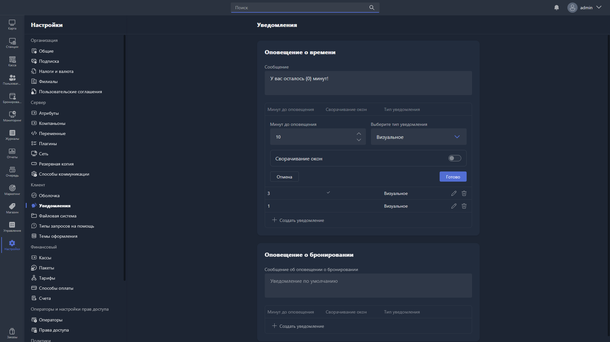

{width=1919px height=1079px}

В этом разделе настраиваются оповещения клиентов для Gizmo Client:

-  оповещение о времени;

-  оповещение о бронировании.

## Оповещение о времени

**Оповещение о времени** -- оповещения, которые показываются или озвучиваются клиенту перед окончанием оплаченного времени.

Для каждого оповещения настраиваются параметры:

-  **Сообщение** -- текст сообщения, которое отображается клиенту. Чтобы показать оставшееся время, используйте переменную `{0}` -- она подставит число минут, например: «У вас осталось {0} минут!». Если поле не заполнено, используется уведомление по умолчанию.

-  **Минут до оповещения** -- за сколько минут до истечения времени будет показано уведомление.

-  **Сворачивание окон** -- при включении все открытые окна на хосте сворачиваются в момент показа уведомления.

-  **Тип уведомления** -- способ оповещения пользователя: визуальное, звуковое или визуальное и звуковое.

Чтобы добавить новое оповещение, нажмите <cmd text="Создать уведомление"/>. Чтобы отредактировать или удалить существующее, используйте иконки карандаша и корзины напротив записи.

## Оповещение о бронировании

**Оповещение о бронировании** -- уведомления, которые получает в Gizmo Client клиент, уже сидящий за пк: скоро начнётся бронь другого клиента, который забронировал этот хост.

Это отдельная настройка от **Времени оповещения клиента о бронировании** в [политике бронирования](./../policies/reservations.md) -- там задаётся общее оповещение, которое показывается на экране забронированного пк.

Для каждого оповещения настраиваются параметры:

-  **Сообщение об оповещении о бронировании** -- текст уведомления о бронировании (можно использовать переменную времени). Если поле не заполнено, используется уведомление по умолчанию.

-  **Минут до оповещения** -- за сколько минут до начала бронирования будет показано уведомление.

-  **Сворачивание окон** -- при включении все открытые окна на хосте сворачиваются в момент показа уведомления.

-  **Тип уведомления** -- способ оповещения пользователя: визуальное, звуковое или визуальное и звуковое.

Чтобы добавить новое оповещение, нажмите <cmd text="Создать уведомление"/>. Чтобы отредактировать или удалить существующее, используйте иконки карандаша и корзины напротив записи.

## Если уведомление не видно или не слышно

-  **Звуковое уведомление** озвучивается синтезатором речи Windows (Text-to-Speech). На клиентском пк должен быть установлен голос нужного языка: **Параметры Windows -> Время и язык -> Речь**. Не все языки поддерживают озвучивание.

-  **Уведомление не появляется во время игры.** В Windows 10 и 11 функция «Фокусировка внимания» («Не беспокоить») скрывает уведомления, пока запущена полноэкранная игра. Отключите её для игр или добавьте Gizmo в список приоритетных приложений.

-  **Уведомление исчезает слишком быстро.** Длительность показа уведомлений задаётся в **Параметры Windows -> Специальные возможности**. Изменить её сразу на всех пк можно задачей -- см. статью [«Полезные скрипты для задач»](./../../articles/useful-task-scripts.md#изменить-длительность-всплывающих-уведомлений).
