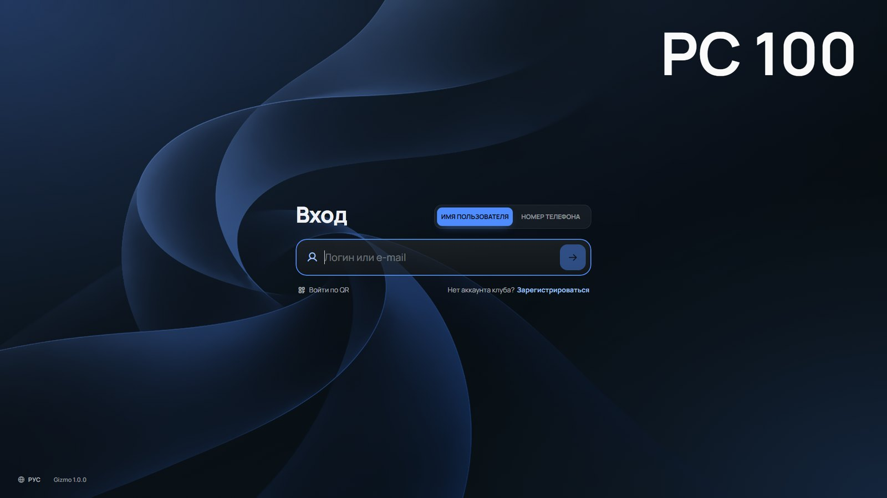
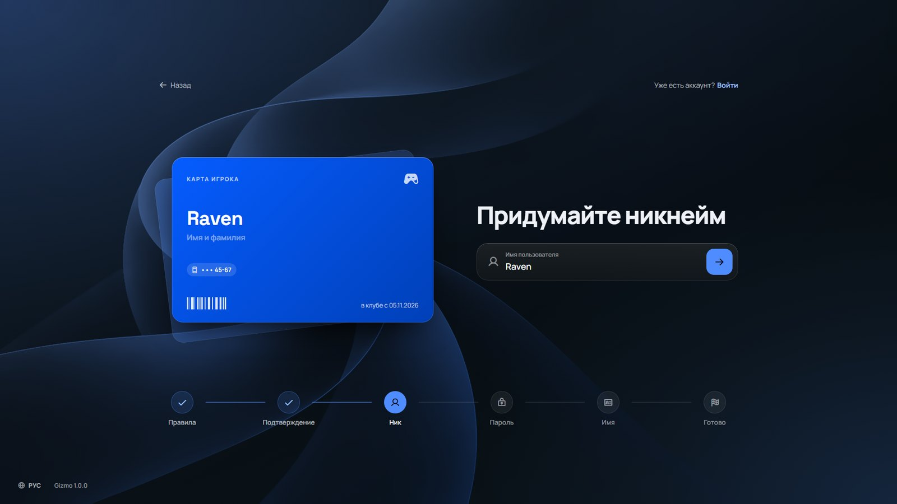
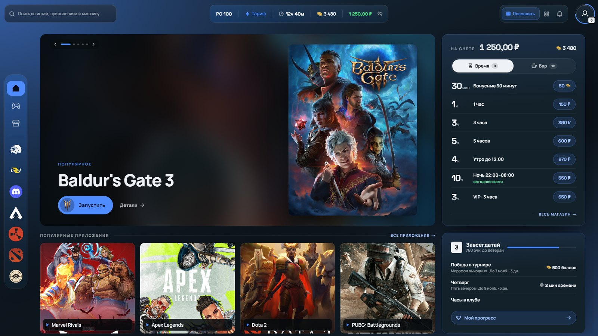
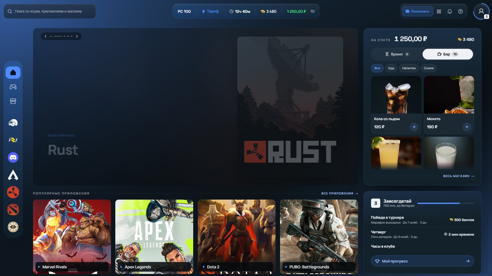
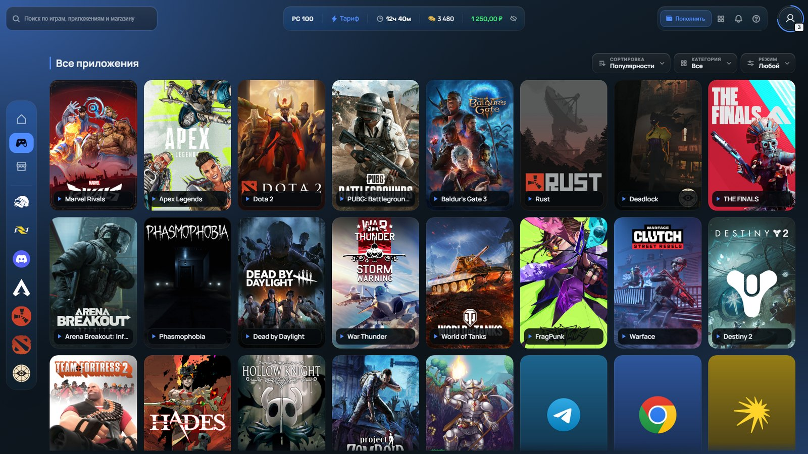
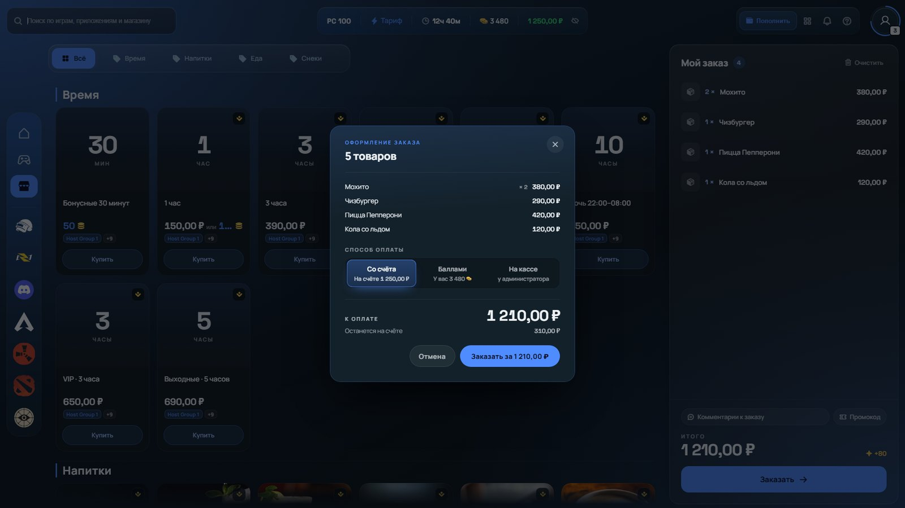
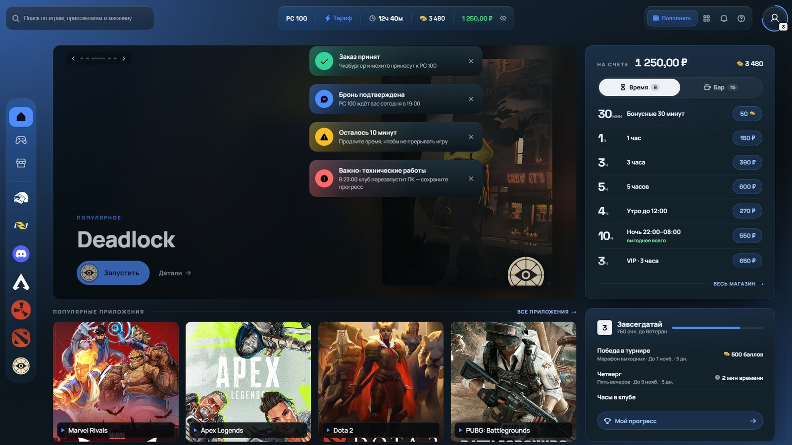
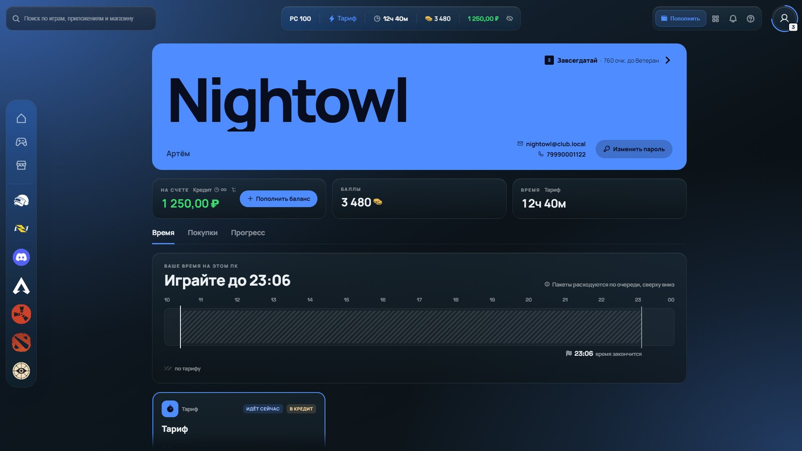
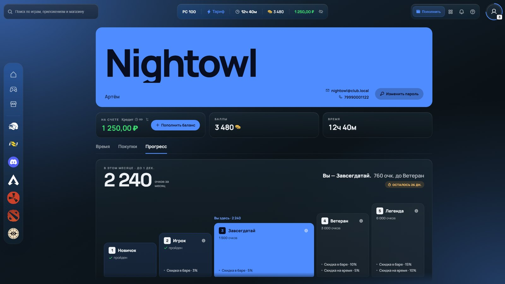
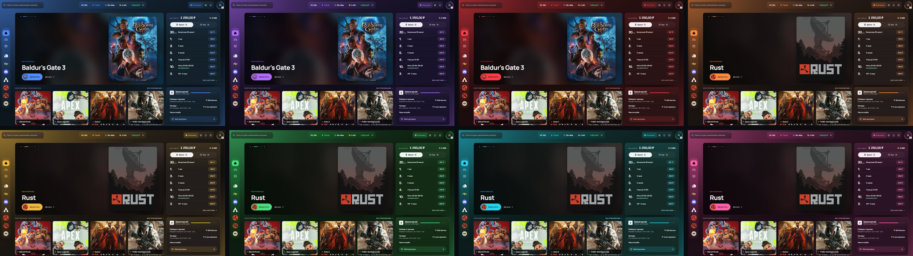

# Оболочка Grafit

Grafit — новая клиентская оболочка для Gizmo V3. Мы всегда считали, что оболочка должна быть не просто окном перед запуском игры, а частью **атмосферы** **клуба** — поэтому **полностью переработали Shell** под требования киберарен.


Статья разделена на две части:

**Обзор оболочки** — что увидят ваши гости и как устроены разделы.

**Настройка оформления** — как сделать оболочку по-настоящему вашей, поменяв акцентный цвет и другие аспекты.

---

## Часть 1. Обзор оболочки

### 1.1 Вход



Войти можно так, как удобнее гостю - по имени пользователя, по номеру телефона или по QR-коду. Пароль вводится вторым шагом, оболочка поздоровается по имени, а если за пк сел другой человек, его легко сменить.

### 1.2 Регистрация



Новый гость может зарегистрироваться сам, прямо за пк, — администратору не нужно отвлекаться. Он принимает правила клуба, верифицирует аккаунт выбранным способом, придумывает ник и пароль.
Пока гость заполняет поля, рядом собирается его карта игрока. Мелочь, но регистрация перестаёт быть скучной анкетой.

### 1.3 Главная



Главная — это витрина клуба. Слева крупно показаны популярные игры, справа все, что связано с продажами, включая баланс, баллы и пакеты времени, которые гость покупает прямо отсюда. Внизу — самые запускаемые приложения и прогресс гостя в системе лояльности.

### 1.4 Бар



Бар живёт прямо на главной, во вкладке кассы. Гость видит напитки и еду с фото и ценами и добавляет их в корзину одним нажатием — до заказа буквально два касания.

### 1.5 Библиотека



Все игры и приложения клуба собраны в одном месте, крупными обложками. Фильтры по категориям помогают быстро найти нужное.

### 1.6 Оформление заказа



Оплатить заказ можно так, как удобно гостю - со счёта, баллами или на кассе у администратора. Если на счёте не хватает, остаток можно доплатить другим способом, а оболочка сразу подскажет, сколько нужно.

### 1.7 Уведомления


### 1.8 Профиль и прогресс



В профиле у гостя под рукой всё о себе - баланс, баллы, оставшееся время и история покупок.



На вкладке «Прогресс» гость видит свой уровень, испытания и достижения. Это хороший повод возвращаться в ваш клуб снова и снова.

---

## Часть 2. Настройка оформления

Внешний вид шелла настраивается в Gizmo Manager, в профиле темы оформления.

### 2.1 Профиль темы оформления

Профиль — это набор настроек внешнего вида для группы станций. Для разных групп можно сделать разные профили: например, VIP-зал в одном цвете, общий — в другом.

1. Откройте **Настройки → Клиент → Темы оформления → Тема по умолчанию,** и выберите Grafit.
2. Создайте профиль оформления — или откройте существующий.
3. Задайте нужные настройки (о них — в пункте 2.2) и сохраните профиль.
4. Откройте **Станции → Группы станций**, выберите группу и в поле **Профиль темы оформления** укажите этот профиль. Также убедитесь, что параметр **Тема оформления** — Grafit.
5. Сохраните изменения и перезапустите Gizmo Client на пк.

Все поля профиля описаны в статье «Карточка профиля темы оформления».

### 2.2 Цвет



У Grafit 8 готовых цветов, по умолчанию стоит синий. При смене цвета перекрашивается вся оболочка целиком, включая кнопки, акценты и фон — так что всё остаётся гармоничным.

В карточке профиля найдите блок **Другое** и в поле **Пользовательский CSS** вставьте строку:

```css
:root { --giz-palette: purple; }
```

Вместо `purple` подойдёт любой из цветов:

| Значение | Цвет |
|---|---|
| `blue` | синий (по умолчанию) |
| `purple` | фиолетовый |
| `red` | красный |
| `orange` | оранжевый |
| `amber` | янтарный |
| `green` | зелёный |
| `teal` | бирюзовый |
| `pink` | розовый |

Хотите цвет точь-в-точь как у логотипа клуба? Укажите его код — все нужные оттенки оболочка подберёт сама:

```css
:root { --giz-palette: #e11d48; }
```

Сохраните профиль и перезапустите Gizmo Client на пк.

Готово — теперь оболочка еще больше соответствует стилю вашей арены!
