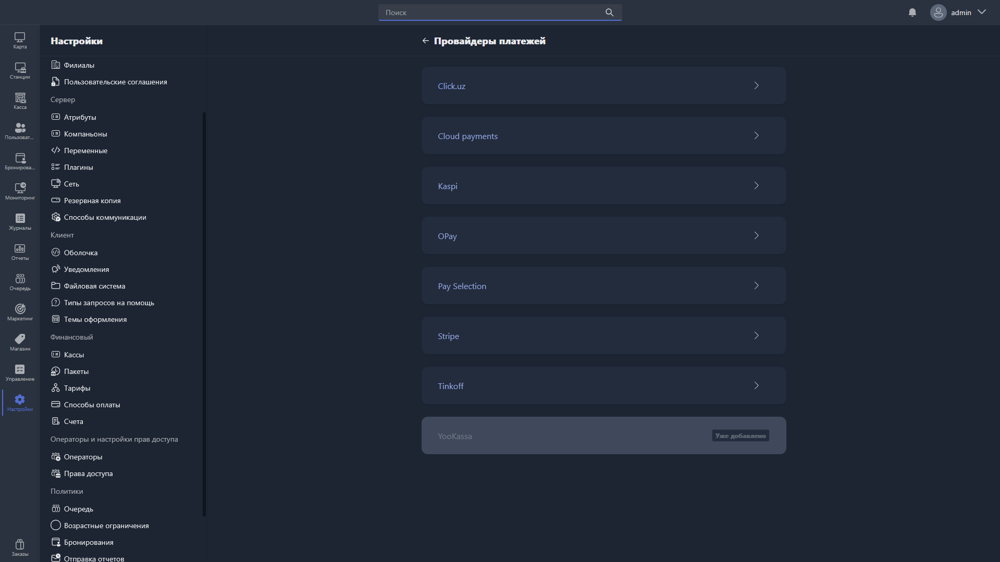
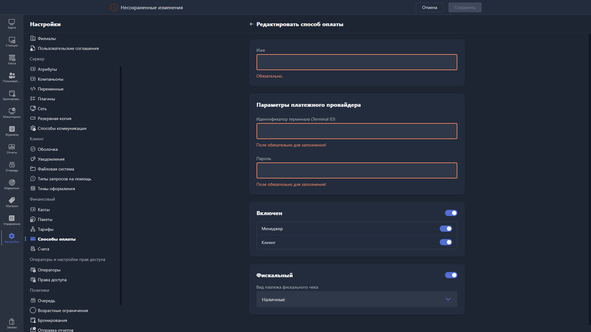

Карточка способа оплаты открывается при создании нового дополнительного способа оплаты. Её тип зависит от выбранного варианта при нажатии кнопки <cmd text="Создать способ оплаты" />.

<tabs>
  <tab name="Не в сети">
    {width=1919px height=1079px}
  </tab>
  <tab name="В сети">
    {width=1919px height=1079px}

    {width=1919px height=1079px}
  </tab>
</tabs>

- **Имя** -- название способа оплаты, отображаемое в интерфейсе. Поле обязательно для заполнения.
- **Включен** -- общий статус способа оплаты. При включении становятся доступны дополнительные настройки:
  - **Менеджер** -- доступность способа оплаты в Gizmo Manager.
  - **Клиент** -- доступность способа оплаты в Gizmo Client.
- **Фискальный** -- при включении способ оплаты учитывается при фискализации чеков. В поле «Вид платежа фискального чека» выбирается тип платежа для отражения в чеке (например, наличные).

Эти поля соответствуют созданию способа оплаты типа **«Не в сети»** -- для приёма платежей без интеграции с внешней платёжной системой.

Чтобы создать онлайн-способ оплаты (**«В сети»**), выберите соответствующий вариант при создании -- откроется страница «Провайдеры платежей» со списком доступных интеграций.

Провайдеры, которые уже добавлены в систему, отмечены меткой «Уже добавлено» и недоступны для повторного выбора. Чтобы подключить нового провайдера, нажмите на его карточку и следуйте инструкциям по настройке интеграции.

## Поля онлайн-провайдеров

У онлайн-способа оплаты, кроме общих полей (**Имя**, **Менеджер**, **Клиент**, **Фискальный**, **Вид платежа фискального чека** -- наличные или банковская карта), есть настройки самого провайдера. Их значения берутся из личного кабинета платёжного сервиса.

| Провайдер | Поля |
|---|---|
| YooKassa (ЮKassa) | **shopId**, **secretKey**, **Поддержка СБП**, **Только СБП** |
| Tinkoff (Т-Банк) | **TerminalID**, **Пароль**, **Только СБП** |
| Cloud Payments | **Public ID**, **Пароль** |
| Pay Selection | **ID сайта**, **Секретный ключ** |
| Stripe | **Secret key**, **Webhook secret key** |
| OPay | **Public key**, **Private key**, **Merchant ID** |
| Kaspi | **Service ID**, **Refer host** |
| Click.uz | **Service ID**, **Secret key**, **Merchant ID**, **Merchant user ID** |
| BPay QR MIA | **Merchant ID**, **Secret key**, **Callback URL**, **Тестовая среда**, **Point ID**, **QR TTL** (секунды) |
| Bakai | **Токен**, **TTL ссылки** (секунды) |

Пошаговая настройка провайдеров -- в инструкции [«Как настроить способы оплаты»](./../../../tutorials/sales/register/payment-methods.md).
