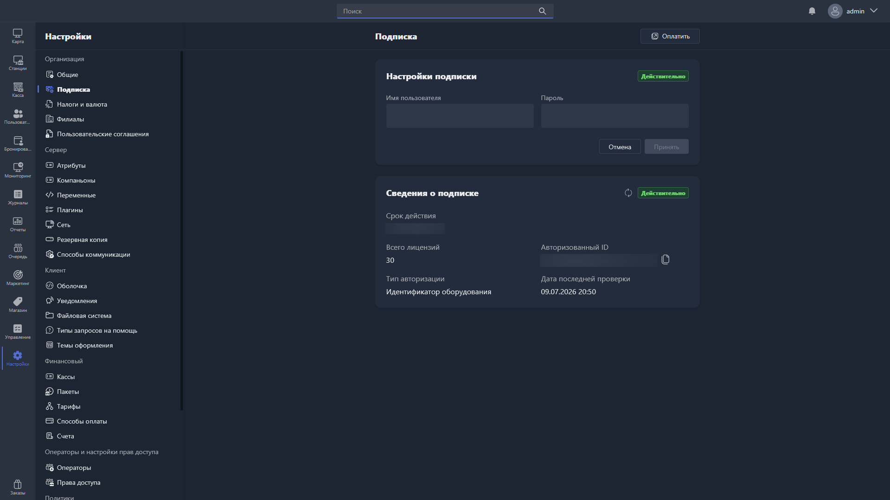

{width=1919px height=1079px}

В этом разделе отображается информация о вашей активной подписке Gizmo.

Чтобы активировать подписку, введите логин и пароль своего аккаунта на сайте Gizmo и нажмите <cmd text="Сохранить" />.

Экран состоит из блока **«Настройки подписки»**, где указан привязанный аккаунт, и блока
**«Сведения о подписке»**. В правом верхнем углу расположена кнопка <cmd text="Оплатить" />.

В подразделе **«Сведения о подписке»** доступна следующая информация:

- **Действительно** -- состояние подписки.
- **Срок действия** -- дата и время окончания подписки.
- **Всего лицензий** -- количество лицензий, включённых в подписку.
- **Авторизованный ID** -- идентификатор, на который выдана подписка.
- **Тип авторизации** -- по какому признаку выдана подписка, например по идентификатору оборудования.
- **Дата последней проверки** -- когда сведения о подписке сверялись с сервером Gizmo в последний раз.

> [!NOTE]
>
> Если информация о подписке отображается некорректно, введите логин и пароль с сайта Gizmo повторно, сохраните изменения и обновите данные кнопкой в разделе «Сведения о подписке».

## Перенос и распределение лицензий

Лицензии управляются в Менеджере лицензий в личном кабинете на сайте Gizmo. Там два режима.

**Простой режим** -- для одного клуба. Все лицензии автоматически назначаются первому серверу, который авторизуется вашим аккаунтом, и новые лицензии тоже добавляются ему. Чтобы перенести лицензии на новый сервер:

1. Выключите старый сервер.
2. Откройте Менеджер лицензий и убедитесь, что включён простой режим.
3. Нажмите **Сброс**.
4. Запустите или перезапустите новый сервер -- лицензии перейдут на него сразу после авторизации.

**Расширенный режим** -- для сети клубов, когда один аккаунт Gizmo используется на нескольких серверах. В нём видны все ID оборудования, которые когда-либо авторизовались вашим аккаунтом; каждый ID -- это отдельный сервер. Чтобы распределить лицензии:

1. Нажмите на значок карандаша рядом с ID оборудования.
2. При желании задайте имя, например название клуба.
3. Укажите, сколько лицензий назначить этому серверу, и сохраните.
4. Повторите для остальных серверов.

Значок корзины удаляет ID оборудования из списка и возвращает его лицензии в пул неназначенных. Опция **Заблокировать** в информации об ID запрещает серверу использовать лицензии, не отзывая их.

> [!IMPORTANT]
>
> Число изменений в месяц ограничено -- его показывает счётчик **Кол-во действий с лицензиями**. Добавление лицензий из пула неназначенных действием не считается; снятие лицензий с ID оборудования -- одно действие; сброс всех ID стоит столько действий, сколько ID сбрасывается. Блокировка действий не тратит.

Как настроить несколько клубов на одном сервере -- в инструкции [«Несколько клубов на одном сервере»](./../../tutorials/operations/multiple-clubs-setup.md).

## Если подписка не распознаётся

Если подписка не отображается как действительная или Gizmo Server не видит лицензии, проверьте по порядку:

1. **Интернет на сервере.** Gizmo Server проверяет лицензию через интернет при запуске, поэтому серверному пк нужен доступ в интернет -- как минимум в момент старта.
2. **Срок подписки.** Войдите в личный кабинет на сайте Gizmo и убедитесь, что подписка действует.
3. **Логин и пароль.** Если вы меняли или восстанавливали пароль на сайте, введите новый пароль в этом разделе и сохраните изменения.
4. **Дата, время и часовой пояс сервера.** Gizmo проверяет лицензии через защищённое соединение, и при неверных дате, времени или часовом поясе на серверном пк проверка не проходит. Исправьте их в настройках операционной системы.
5. **Перезапуск сервера.** После покупки или продления подписки, смены пароля или исправления времени перезапустите Gizmo Server -- см. инструкцию [«Как перезапустить сервер Gizmo»](./../../tutorials/operations/server-restart.md).

Если подписка по-прежнему не распознаётся, [обратитесь в поддержку](./../../about/support.md).
