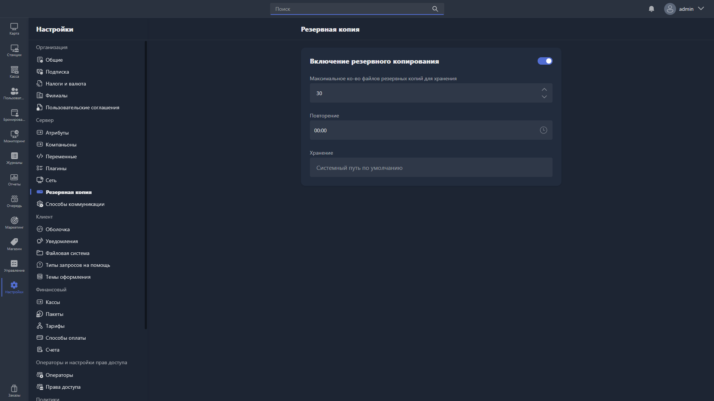

{width=1919px height=1079px}

**Резервная копия** -- копия базы данных вашего Gizmo Server. Она нужна для переноса базы данных на другой сервер или для её восстановления.

В этом разделе настраивается автоматическое резервное копирование базы данных Gizmo Server:

-  включение и выключение резервного копирования;

-  максимальное количество хранимых файлов резервных копий;

-  повторение -- расписание создания копий;

-  хранение -- путь, по которому копии сохраняются.

> [!IMPORTANT]
>
> Встроенное резервное копирование работает только с базой Microsoft SQL Server, установленной на том же пк, что и Gizmo Server. Если используется PostgreSQL или база находится на другом сервере, делайте копии средствами СУБД -- см. раздел [«Ручная копия и восстановление»](#ручная-копия-и-восстановление).

## Включение резервного копирования

По умолчанию резервное копирование отключено. Чтобы включить его, нажмите переключатель -- станут доступны дополнительные параметры. При выключении переключателя эти параметры становятся неактивными.

## Максимальное количество файлов резервных копий для хранения

**Максимальное количество файлов резервных копий для хранения** -- целое значение, которое задаёт, сколько резервных копий хранить одновременно. По умолчанию -- 10.

Например, если резервная копия создаётся ежедневно, а лимит равен 10, то после создания одиннадцатой копии Gizmo Server автоматически удалит самую старую. Так на сервере всегда будут храниться только 10 последних копий базы данных.

## Повторение

**Повторение** -- расписание резервного копирования: время, в которое будет создана резервная копия. По умолчанию -- 0:00 (в полночь).

## Хранение

**Хранение** -- путь в файловой системе, по которому будут сохраняться резервные копии.

Указывайте полный путь до нужной папки и учитывайте различия в построении путей между операционными системами.

> [!WARNING]
> 
> Убедитесь, что пользователь операционной системы, от имени которого запущен Gizmo Server, обладает правами на чтение и запись в указанную папку.

### Пути по умолчанию

<table header="row">
<tr>
<td>

Вариант установки

Gizmo Server

</td>
<td colspan="2">

Путь резервных копий по умолчанию

</td>
</tr>
<tr>
<td>

Windows

</td>
<td colspan="2">

`C:\Program Files\NETProjects\Gizmo Server\data\Backup`

</td>
</tr>
<tr>
<td>

Linux

</td>
<td colspan="2">

`/opt/gizmo-service/backup`

</td>
</tr>
<tr>
<td>

Docker

</td>
<td colspan="2">

`/app/mount/backup`

</td>
</tr>
</table>

## Ручная копия и восстановление

Помимо автоматического копирования, базу данных можно сохранить и восстановить вручную -- средствами самой СУБД. Это нужно, например, перед обновлением или при [переносе Gizmo на другой сервер](./../../tutorials/operations/server-migration.md).

> [!WARNING]
>
> Перед восстановлением базы остановите Gizmo Server -- см. инструкцию [«Как перезапустить сервер Gizmo»](./../../tutorials/operations/server-restart.md).

<tabs>

<tab name="Microsoft SQL Server">

**Через ConfigurationTool** -- если Microsoft SQL Server установлен на том же пк, что и Gizmo Server:

1. Откройте **ConfigurationTool** -- ярлыком на рабочем столе или из папки `C:\Program Files\NETProjects\Gizmo Server\tools\configuration`.
2. Нажмите **Резервное копирование базы данных**, чтобы создать копию, или **Восстановить базу данных**, чтобы восстановить базу из копии.

**Через SQL Server Management Studio** -- если база на другом сервере или нужен больший контроль.

Используйте [SQL Server Management Studio](https://learn.microsoft.com/ru-ru/sql/ssms/download-sql-server-management-studio-ssms) (SSMS).

**Создать копию**

1. Запустите SSMS и подключитесь к экземпляру SQL Server, на котором работает база Gizmo.
2. Разверните **Базы данных**, нажмите правой кнопкой мыши на базу Gizmo и выберите **Задачи -> Создать резервную копию...**.
3. Проверьте папку назначения и нажмите **ОК**.

**Восстановить из копии**

1. В SSMS нажмите правой кнопкой мыши на **Базы данных** и выберите **Восстановить базу данных...**.
2. Выберите **Устройство**, укажите файл резервной копии и нажмите **ОК**.

</tab>

<tab name="PostgreSQL">

Используйте утилиты `pg_dump` и `pg_restore` из комплекта PostgreSQL.

**Создать копию**

```
pg_dump -U <пользователь> -F c -f gizmo.backup <имя базы>
```

**Восстановить из копии**

```
pg_restore -U <пользователь> -d <имя базы> --clean gizmo.backup
```

Подробнее -- в [документации PostgreSQL](https://www.postgresql.org/docs/current/backup-dump.html).

</tab>

</tabs>

> [!TIP]
>
> Для регулярных копий можно использовать и сторонние инструменты, например [SQLBackupAndFTP](https://sqlbackupandftp.com/): он умеет копировать базы MS SQL и PostgreSQL по расписанию и отправлять копии в облако. Как хранить копии вне сервера -- в инструкции [«Резервное копирование в облако»](./../../tutorials/operations/cloud-backup.md).
