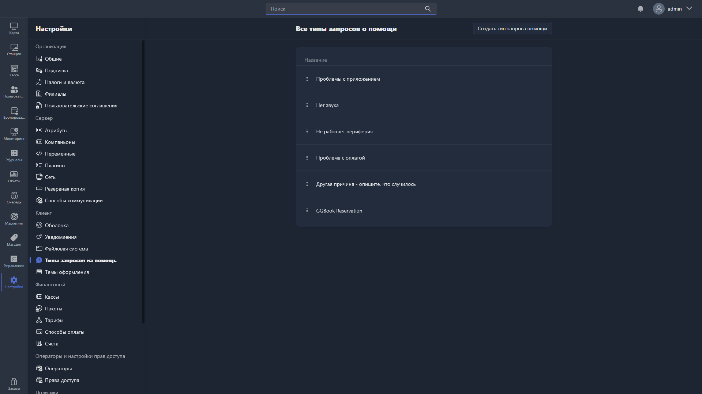

Здесь настраиваются типы запросов о помощи, которые пользователь может отправить оператору через интерфейс Gizmo Client.

{width=1919px height=1079px}

<note type="hotfixes" title="Перечень определений" collapsed="true">

В списке отображаются все созданные типы запросов. Порядок их отображения можно изменить, перетаскивая элементы за иконку перетаскивания <icon code="grip-vertical" /> слева от названия.

Чтобы создать новый тип запроса, нажмите <cmd text="Создать тип запроса помощи"/> в правом углу страницы.

### Создание типа запроса

При создании нового типа запроса нужно заполнить поле:

-  **Название** -- наименование типа запроса, которое будет отображаться пользователю в Gizmo Client. Поле обязательно для заполнения.

</note>

<note type="hotfixes" title="Влияние на систему" collapsed="true">

> [!NOTE]
>
> Данный раздел находится в разработке.

</note>

<note type="hotfixes" title="Заключение" collapsed="true">

Типы запросов на помощь позволяют пользователю выбрать подходящий вариант обращения к оператору прямо в Gizmo Client.

</note>
