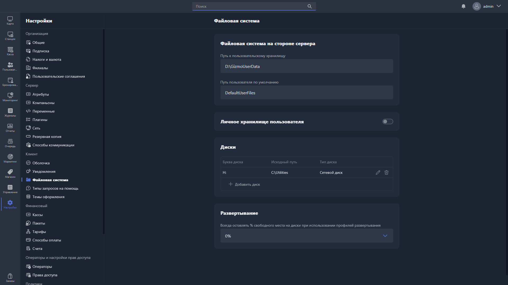

В этом разделе настраивается файловая система на стороне сервера, личное хранилище пользователей, а также виртуальные диски и параметры развёртывания файлов на хостах.

{width=1919px height=1079px}

<note type="hotfixes" title="Перечень определений" collapsed="true">

### Файловая система на стороне сервера

-  **Путь к пользовательскому хранилищу** -- путь к директории на сервере, в которой хранятся личные файлы пользователей.

-  **Путь пользователя по умолчанию** -- путь к директории, которая используется как папка по умолчанию для новых пользователей при первом входе.

### Личное хранилище пользователя

**Личное хранилище пользователя** -- опция, которая включает личное хранилище файлов для каждого пользователя.

### Диски

Здесь настраиваются виртуальные диски, которые монтируются на хостах.

Для каждого диска указываются параметры:

-  **Буква диска** -- буква, под которой диск отображается в системе на хосте.

-  **Исходный путь** -- путь к директории на сервере, которая будет смонтирована как диск.

-  **Тип диска** -- тип монтирования виртуального диска.

Чтобы добавить диск, нажмите <cmd text="Добавить диск"/>. Чтобы удалить диск, используйте иконку корзины напротив записи.

### Развёртывание

**Всегда оставлять % свободного места на диске при использовании профилей развертывания** -- минимальный процент свободного места на диске хоста, который Gizmo должен оставлять при развёртывании файлов.

</note>

<note type="hotfixes" title="Влияние на систему" collapsed="true">

-  При включении опции **Личное хранилище пользователя** каждый пользователь получает личное хранилище файлов, доступное ему при входе на любой хост.

-  Если после развёртывания свободного места на диске хоста останется меньше значения из поля **Всегда оставлять % свободного места на диске при использовании профилей развертывания**, операция будет прервана.

</note>

<note type="hotfixes" title="Заключение" collapsed="true">

Настройки файловой системы определяют, где на сервере хранятся файлы пользователей, какие виртуальные диски монтируются на хостах и сколько свободного места на них сохраняется при развёртывании.

</note>
