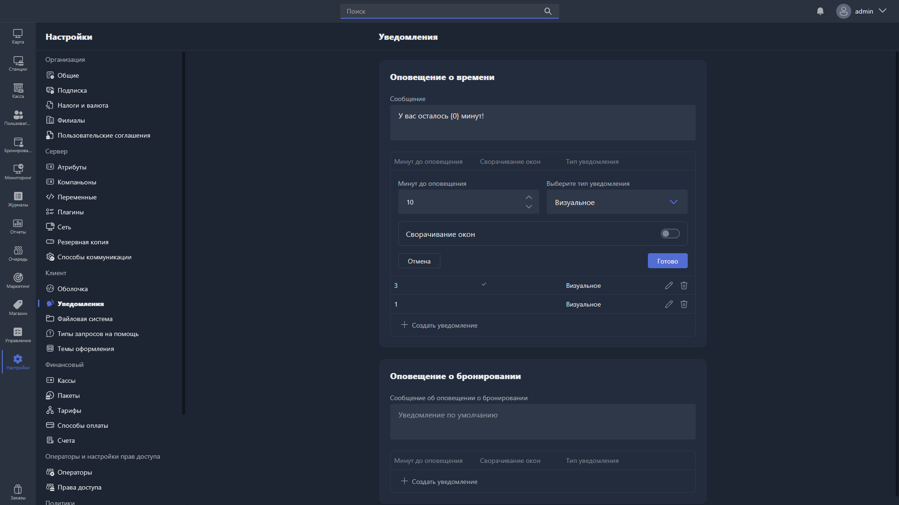

В этом разделе настраиваются оповещения клиентов для Gizmo Client: оповещение о времени и оповещение о бронировании.

{width=1919px height=1079px}

<note type="hotfixes" title="Перечень определений" collapsed="true">

### Оповещение о времени

**Оповещение о времени** -- оповещения, которые показываются или озвучиваются клиенту перед окончанием оплаченного времени.

Для каждого оповещения настраиваются параметры:

-  **Сообщение** -- текст сообщения, которое отображается клиенту (можно использовать переменную времени). Если поле не заполнено, используется уведомление по умолчанию.

-  **Минут до оповещения** -- за сколько минут до истечения времени будет показано уведомление.

-  **Сворачивание окон** -- при включении все открытые окна на хосте сворачиваются в момент показа уведомления.

-  **Тип уведомления** -- способ оповещения пользователя: визуальное, звуковое или визуальное и звуковое.

Чтобы добавить новое оповещение, нажмите <cmd text="Создать уведомление"/>. Чтобы отредактировать или удалить существующее, используйте иконки карандаша и корзины напротив записи.

### Оповещение о бронировании

**Оповещение о бронировании** -- уведомления, которые получает в Gizmo Client клиент, уже сидящий за пк: скоро начнётся бронь другого клиента, который забронировал этот хост.

Для каждого оповещения настраиваются параметры:

-  **Сообщение об оповещении о бронировании** -- текст уведомления о бронировании (можно использовать переменную времени). Если поле не заполнено, используется уведомление по умолчанию.

-  **Минут до оповещения** -- за сколько минут до начала бронирования будет показано уведомление.

-  **Сворачивание окон** -- при включении все открытые окна на хосте сворачиваются в момент показа уведомления.

-  **Тип уведомления** -- способ оповещения пользователя: визуальное, звуковое или визуальное и звуковое.

Чтобы добавить новое оповещение, нажмите <cmd text="Создать уведомление"/>. Чтобы отредактировать или удалить существующее, используйте иконки карандаша и корзины напротив записи.

</note>

<note type="hotfixes" title="Влияние на систему" collapsed="true">

-  **Оповещение о бронировании** -- это отдельная настройка от **Времени оповещения клиента о бронировании** в [политике бронирования](./../policies/reservations.md) -- там задаётся общее оповещение, которое показывается на экране забронированного пк.

</note>

<note type="hotfixes" title="Заключение" collapsed="true">

Уведомления помогают клиенту вовремя узнать об окончании оплаченного времени и о приближении чужой брони на занятом им хосте. Как оповещения связаны с бронью -- в разделе [«Бронирования»](./../../usage/gizmo-manager/reservations/_index.md).

</note>
