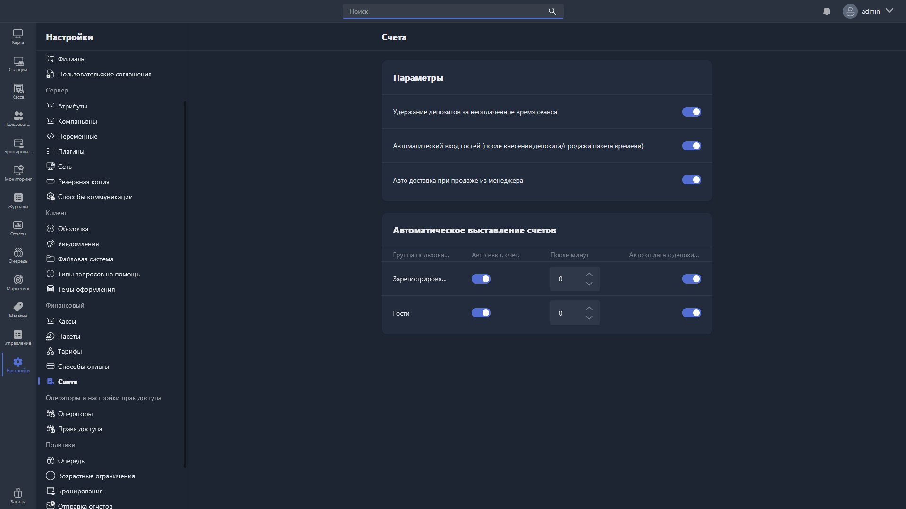

В этом разделе настраиваются параметры выставления и оплаты счетов в Gizmo.

{width=1919px height=1079px}

<note type="hotfixes" title="Перечень определений" collapsed="true">

### Параметры

-  **Удержание депозитов за неоплаченное время сеанса** -- при включении сумма за неоплаченное время сеанса автоматически списывается с депозита пользователя при закрытии баланса.

-  **Автоматический вход гостей (после внесения депозита/продажи пакета времени)** -- при включении гостевой пользователь автоматически входит в систему на хосте сразу после пополнения депозита или покупки пакета времени.

-  **Авто доставка при продаже из менеджера** -- при включении товары и пакеты времени, проданные через Gizmo Manager, считаются доставленными автоматически, без подтверждения оператором.

### Автоматическое выставление счетов

Здесь настраивается автоматическое выставление и оплата счетов для каждой группы пользователей.

Таблица содержит столбцы:

-  **Группа пользователей** -- группа, для которой применяются настройки.

-  **Авто выст. счет.** -- при включении счёт выставляется пользователю автоматически по окончании сеанса.

-  **После минут** -- количество минут после завершения сеанса, по истечении которых счёт выставляется автоматически.

-  **Авто оплата с депозитов** -- при включении выставленный счёт автоматически оплачивается с депозита пользователя.

</note>

<note type="hotfixes" title="Влияние на систему" collapsed="true">

-  Пока параметры выключены, списание с депозита, вход гостя на хост и доставка проданных через Gizmo Manager товаров и пакетов времени автоматически не выполняются.

-  Настройки автоматического выставления счетов применяются отдельно к каждой группе пользователей: счёт выставляется через число минут из столбца **После минут** после завершения сеанса, а при включённой **Авто оплата с депозитов** автоматически оплачивается с депозита пользователя.

</note>

<note type="hotfixes" title="Заключение" collapsed="true">

Настройки счетов позволяют автоматизировать выставление и оплату счетов, списание с депозита и доставку проданных товаров и пакетов времени без участия оператора.

</note>
