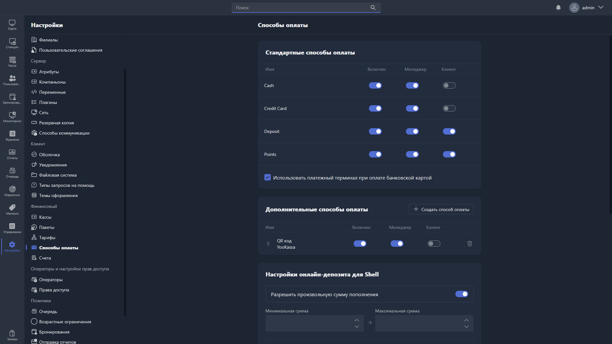

В этом разделе настраиваются способы оплаты, доступные в Gizmo Manager и Gizmo Client.

{width=1919px height=1079px}

<note type="hotfixes" title="Перечень определений" collapsed="true">

### Стандартные способы оплаты

Стандартные способы оплаты встроены в систему и не могут быть удалены. Для каждого из них можно настроить доступность:

-  **Включен** -- общий статус способа оплаты в системе.

-  **Менеджер** -- доступность способа оплаты в Gizmo Manager.

-  **Клиент** -- доступность способа оплаты в Gizmo Client.

Доступные стандартные способы оплаты:

-  **Cash** -- наличные.

-  **Credit Card** -- банковская карта.

-  **Deposit** -- оплата с депозита пользователя.

-  **Points** -- оплата баллами лояльности.

**Использовать платежный терминал при оплате банковской картой** -- при включении оплата картой проводится через подключённый платёжный терминал. Доступны два режима работы терминала:

-  **Не в сети** -- терминал работает в офлайн-режиме.

-  **В сети** -- терминал работает в онлайн-режиме.

### Дополнительные способы оплаты

Здесь настраиваются пользовательские способы оплаты -- например, интеграции с платёжными системами (YooKassa, Tinkoff и другими).

Таблица показывает все созданные дополнительные способы оплаты. Для каждого доступны те же настройки, что и для стандартных: **Включен**, **Менеджер**, **Клиент**. Порядок отображения можно изменить перетаскиванием за иконку перетаскивания <icon code="grip-vertical" />, а чтобы удалить способ оплаты, нажмите иконку корзины.

Чтобы создать новый способ оплаты, нажмите <cmd text="Создать способ оплаты"/> -- поля для заполнения описаны в статье [«Карточка способа оплаты»](./payment-method-card.md).

### Настройки онлайн-депозита для Shell

Здесь настраивается пополнение депозита пользователем через интерфейс Gizmo Client.

-  **Разрешить произвольную сумму пополнения** -- при включении пользователь может самостоятельно ввести любую сумму пополнения в пределах установленных лимитов.

-  **Минимальная сумма** -- минимальная сумма, которую пользователь может пополнить за один раз.

-  **Максимальная сумма** -- максимальная сумма, которую пользователь может пополнить за один раз.

-  **Шаблоны** -- фиксированные суммы пополнения, отображаемые пользователю в виде кнопок быстрого выбора. Чтобы добавить шаблон, нажмите <cmd text="Добавить шаблон"/>, укажите сумму и нажмите <cmd text="Готово"/>.

### Другое

-  **URL для успешного платежа** -- адрес страницы, на которую перенаправляется пользователь после успешной оплаты онлайн.

-  **URL для неуспешных платежей** -- адрес страницы, на которую перенаправляется пользователь в случае неудачной оплаты онлайн.

</note>

<note type="hotfixes" title="Влияние на систему" collapsed="true">

-  Переключатели **Менеджер** и **Клиент** определяют, в каком приложении способ оплаты доступен: в Gizmo Manager, в Gizmo Client или в обоих.

-  При включённой настройке **Использовать платежный терминал при оплате банковской картой** оплата картой проводится через подключённый платёжный терминал в выбранном режиме -- **Не в сети** или **В сети**.

-  Настройки онлайн-депозита определяют, какие суммы пользователь может внести на депозит через Gizmo Client: шаблоны из поля **Шаблоны** и, если включена **Разрешить произвольную сумму пополнения**, -- любую сумму в пределах **Минимальная сумма** и **Максимальная сумма**.

-  После онлайн-оплаты пользователь перенаправляется на страницу из поля **URL для успешного платежа** или **URL для неуспешных платежей** в зависимости от результата.

</note>

<note type="hotfixes" title="Заключение" collapsed="true">

Раздел позволяет определить, какими способами пользователи и операторы могут оплачивать услуги в Gizmo Manager и Gizmo Client. Чтобы подключить новый способ оплаты, воспользуйтесь статьёй [«Карточка способа оплаты»](./payment-method-card.md).

</note>
