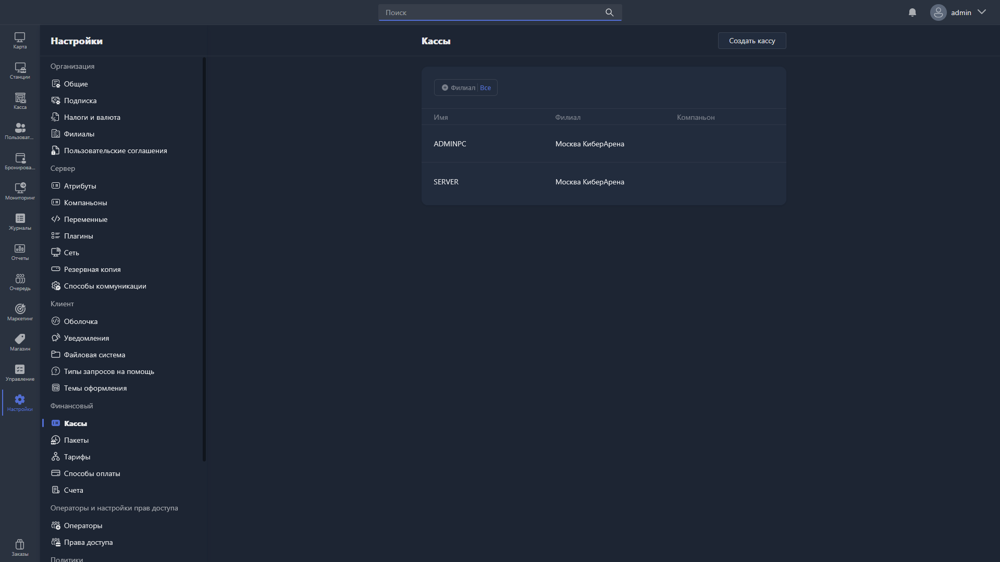

Здесь настраиваются кассы, используемые в Gizmo Manager при проведении финансовых операций.

{width=1919px height=1079px}

<note type="hotfixes" title="Перечень определений" collapsed="true">

В таблице отображаются все созданные кассы. Список можно отфильтровать по филиалу, нажав на фильтр «Филиал».

Таблица содержит столбцы:

-  **Имя** -- название кассы.

-  **Филиал** -- филиал, к которому привязана касса.

-  **Компаньон** -- Gizmo Companion, связанный с этой кассой.

Чтобы создать новую кассу, нажмите <cmd text="Создать кассу"/> в правом углу страницы.

Чтобы отредактировать существующую, нажмите на соответствующую строку в таблице -- откроется [карточка кассы](./register-card.md).

</note>

<note type="hotfixes" title="Влияние на систему" collapsed="true">

> [!NOTE]
>
> Данный раздел находится в разработке.

</note>

<note type="hotfixes" title="Заключение" collapsed="true">

Раздел позволяет создать и настроить кассы, через которые в Gizmo Manager проводятся финансовые операции. Параметры отдельной кассы описаны в статье [«Карточка кассы»](./register-card.md).

</note>
