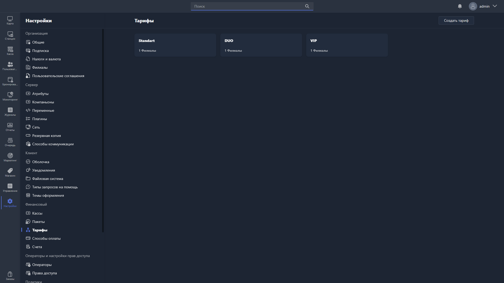

В этом разделе настраиваются профили тарификации -- правила начисления оплаты за время, проведённое пользователем на хосте.

{width=1919px height=1079px}

<note type="hotfixes" title="Перечень определений" collapsed="true">

Все созданные тарифы отображаются в виде карточек: на каждой -- название профиля и количество привязанных филиалов.

Чтобы создать новый тариф, нажмите <cmd text="Создать тариф"/> в правом углу страницы.

Чтобы отредактировать существующий тариф, нажмите на его карточку -- откроется [карточка тарифа](./tariff-card.md).

</note>

<note type="hotfixes" title="Влияние на систему" collapsed="true">

> [!NOTE]
>
> Данный раздел находится в разработке.

</note>

<note type="hotfixes" title="Заключение" collapsed="true">

Раздел позволяет создать профили тарификации, по которым пользователю начисляется оплата за время на хосте. Параметры отдельного тарифа описаны в статье [«Карточка тарифа»](./tariff-card.md).

</note>
