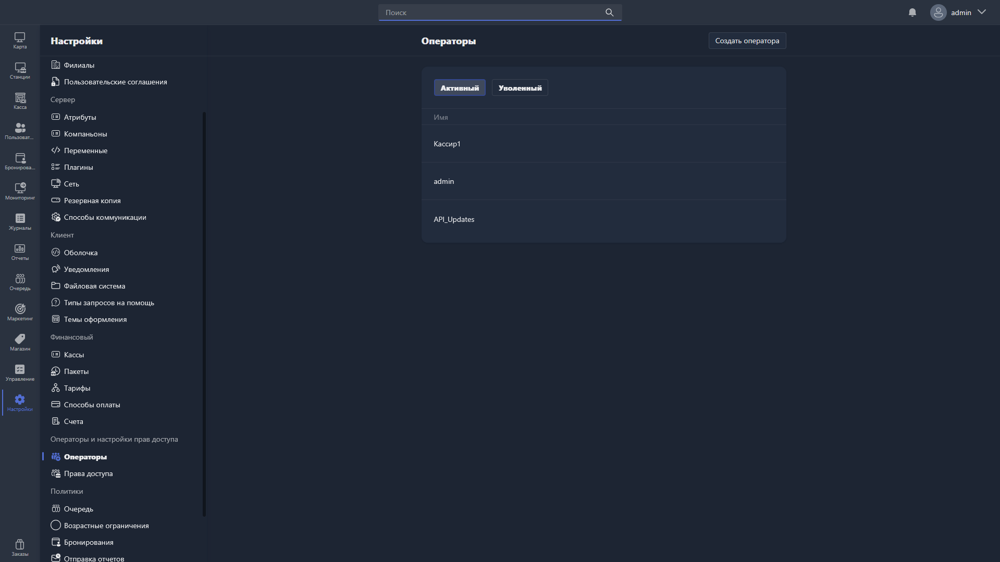

Здесь управляются учётные записи операторов -- сотрудников, работающих в Gizmo Manager.

{width=1919px height=1079px}

<note type="hotfixes" title="Перечень определений" collapsed="true">

Список операторов разделён на две вкладки:

-  **Активный** -- операторы, которые в данный момент работают в системе.

-  **Уволенный** -- операторы, которые были уволены и лишены доступа к системе.

В таблице отображается имя каждого оператора. Чтобы отредактировать оператора, нажмите на соответствующую строку -- откроется [карточка оператора](./operators-card.md).

Чтобы создать нового оператора, нажмите <cmd text="Создать оператора"/> в правом углу страницы.

</note>

<note type="hotfixes" title="Влияние на систему" collapsed="true">

-  Уволенный оператор теряет доступ к системе и перемещается на вкладку **Уволенный**.

</note>

<note type="hotfixes" title="Заключение" collapsed="true">

Раздел позволяет создавать учётные записи операторов и управлять ими. Параметры отдельного оператора описаны в статье [«Карточка оператора»](./operators-card.md).

</note>
