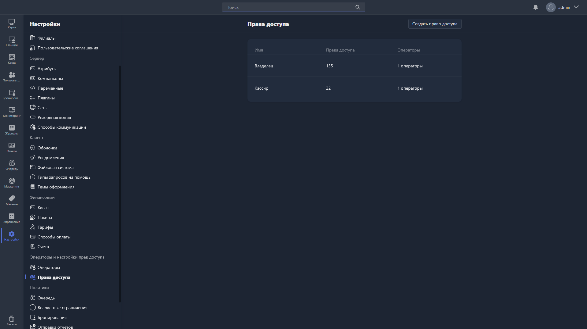

Здесь настраиваются предустановки прав доступа -- наборы разрешений, которые назначаются операторам.

{width=1919px height=1079px}

<note type="hotfixes" title="Перечень определений" collapsed="true">

В таблице отображаются все созданные предустановки:

-  **Имя** -- название предустановки.

-  **Права доступа** -- общее количество включённых разрешений.

-  **Операторы** -- количество операторов, которым назначена предустановка.

Чтобы создать новую предустановку, нажмите <cmd text="Создать право доступа"/> в правом углу страницы.

Чтобы отредактировать существующую, нажмите на соответствующую строку в таблице -- откроется [карточка прав доступа](./permission-card.md).

</note>

<note type="hotfixes" title="Влияние на систему" collapsed="true">

-  Предустановка определяет, какие действия доступны в системе операторам, которым она назначена в [карточке оператора](./../operators/operators-card.md).

</note>

<note type="hotfixes" title="Заключение" collapsed="true">

Предустановки прав доступа позволяют задать наборы разрешений и назначать их операторам. Состав разрешений описан в статье [«Карточка прав доступа»](./permission-card.md).

</note>
