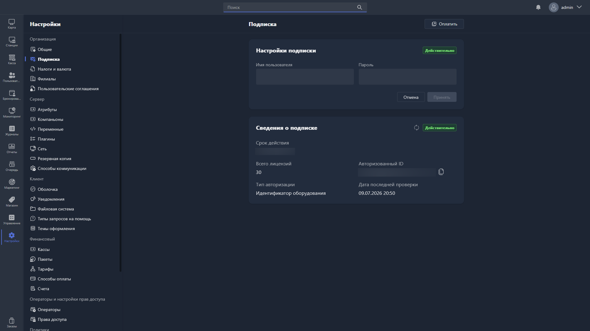

В этом разделе отображается информация о вашей активной подписке Gizmo.

{width=1919px height=1079px}

<note type="hotfixes" title="Перечень определений" collapsed="true">

Экран состоит из блока **«Настройки подписки»**, где указан привязанный аккаунт, и блока
**«Сведения о подписке»**. В правом верхнем углу расположена кнопка <cmd text="Оплатить"/>.

Чтобы активировать подписку, введите логин и пароль своего аккаунта на сайте Gizmo и нажмите <cmd text="Сохранить"/>.

В подразделе **«Сведения о подписке»** доступна следующая информация:

-  **Действительно** -- состояние подписки.

-  **Срок действия** -- дата и время окончания подписки.

-  **Всего лицензий** -- количество лицензий, включённых в подписку.

-  **Авторизованный ID** -- идентификатор, на который выдана подписка.

-  **Тип авторизации** -- по какому признаку выдана подписка, например по идентификатору оборудования.

-  **Дата последней проверки** -- когда сведения о подписке сверялись с сервером Gizmo в последний раз.

> [!NOTE]
> 
> Если информация о подписке отображается некорректно, введите логин и пароль с сайта Gizmo повторно, сохраните изменения и обновите данные кнопкой в разделе «Сведения о подписке».

</note>

<note type="hotfixes" title="Влияние на систему" collapsed="true">

> [!NOTE]
>
> Данный раздел находится в разработке.

</note>

<note type="hotfixes" title="Заключение" collapsed="true">

Раздел позволяет активировать подписку Gizmo через аккаунт на сайте Gizmo и проверить её состояние, срок действия и количество лицензий.

</note>
