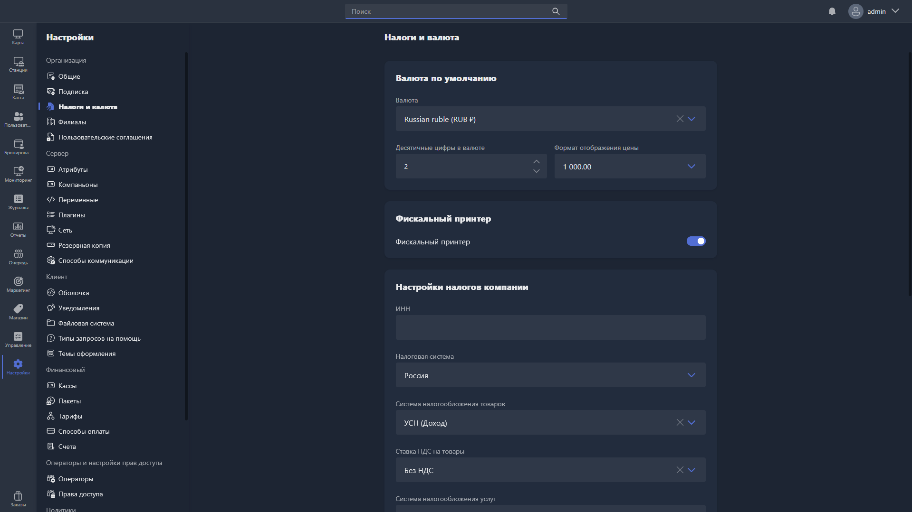

В этом разделе настраивается налоговый режим организации и параметры валюты.

{width=1919px height=1079px}

<note type="hotfixes" title="Перечень определений" collapsed="true">

### Настройки валюты

Здесь настраивается используемая валюта и варианты её отображения.

Отображение валюты настраивается двумя параметрами:

-  количество символов после запятой;

-  формат отображения.

Доступные форматы отображения:

<table header="row">
<colgroup><col width="48"/><col width="260"/><col width="478"/></colgroup>
<tr>
<td>

\#

</td>
<td>

Визуальное представление

</td>
<td>

Описание

</td>
</tr>
<tr>
<td>

1

</td>
<td>

1000\.00

</td>
<td>

разделитель целой части -- точка

разделитель тысячной части -- отсутствует

</td>
</tr>
<tr>
<td>

2

</td>
<td>

1 000.00

</td>
<td>

разделитель целой части -- точка

разделитель тысячной части -- пробел

</td>
</tr>
<tr>
<td>

3

</td>
<td>

1,000.00

</td>
<td>

разделитель целой части -- точка

разделитель тысячной части -- запятая

</td>
</tr>
<tr>
<td>

4

</td>
<td>

1\.000,00

</td>
<td>

разделитель целой части -- запятая

разделитель тысячной части -- точка

</td>
</tr>
<tr>
<td>

5

</td>
<td>

1000,00

</td>
<td>

разделитель целой части -- запятая

разделитель тысячной части -- отсутствует

</td>
</tr>
<tr>
<td>

6

</td>
<td>

1 000,00

</td>
<td>

разделитель целой части -- запятая

разделитель тысячной части -- пробел

</td>
</tr>
</table>

### Фискальный принтер

**Фискальный принтер** -- переключатель типа принтера для печати чеков. Включён -- используется фискальный принтер, выключен -- обычный.

Пошаговая настройка -- в инструкции [«Фискализация чеков в РФ»](./../../../../user-manual/contents/tutorials/sales/register/fiscalization.md).

### Настройки налогов

Здесь настраивается налоговый режим организации.

<table header="row">
<colgroup><col width="250"/><col width="260"/><col width="260"/></colgroup>
<tr>
<td>

Название настройки

</td>
<td>

Описание

</td>
<td>

Варианты

</td>
</tr>
<tr>
<td>

ИНН

</td>
<td>

Налоговый идентификатор вашей организации

</td>
<td>

</td>
</tr>
<tr>
<td>

Страна

</td>
<td>

Страна регистрации вашей организации

</td>
<td>

</td>
</tr>
<tr>
<td>

Налоговая система для товаров / услуг / депозита

</td>
<td>

Налоговая система, которая будет указана в чеке при пробитии товаров / услуг / депозита

</td>
<td>

-  Основная

-  УСН доход

-  УСН доход минус расход

-  ЕСХН

-  Патент

</td>
</tr>
<tr>
<td>

НДС для товаров / услуг / депозита

</td>
<td>

Налог на добавленную стоимость для товаров / услуг / депозита

</td>
<td>

-  Без НДС

-  0%

-  5%

-  7%

-  10%

-  20%

-  22%

-  5/105%

-  7/107%

-  10/110%

-  20/120%

-  22/122%

</td>
</tr>
<tr>
<td>

Депозит как услуга

</td>
<td>

Опция, при включении которой операции пополнения депозита расцениваются не как авансовый платёж, а как услуга с полным расчётом

</td>
<td>

</td>
</tr>
<tr>
<td>

Название услуги депозита

</td>
<td>

Наименование, которое будет указано в чеке при пополнении депозита

</td>
<td>

</td>
</tr>
</table>

### Налог на продажу времени

Здесь указывается процент налога, который учитывается при продаже поминутного тарифа.

### Налоги

Здесь можно создать налоговые ставки на товары (НДС).

Чтобы добавить ставку, нажмите <cmd text="Создать налог"/> в правом углу подраздела и заполните столбцы «Имя» и «Значение» в появившейся строке. Значения указываются в процентах, формат -- `5.20`.

Чтобы удалить ставку, нажмите на иконку корзины напротив неё.

Чтобы изменить порядок ставок в списке, зажмите значок перетаскивания <icon code="grip-vertical" /> справа от нужного значения и перетащите его на нужную позицию.

</note>

<note type="hotfixes" title="Влияние на систему" collapsed="true">

-  Выбранная валюта учитывается при отображении транзакций как в Gizmo Manager, так и в Gizmo Client.

-  Параметры блока «Настройки налогов» учитываются при фискализации платежей.

> [!NOTE]
> 
> Подробнее об особенностях работы Gizmo при разных настройках налогообложения -- в инструкции [«Фискализация чеков в РФ»](./../../../../user-manual/contents/tutorials/sales/register/fiscalization.md).

> [!WARNING]
> 
> Настройка «Фискальный принтер» глобальна для всех филиалов. При необходимости её можно отключить для конкретного филиала [в разделе «Филиалы»](./branches/_index.md).
>
> Настройки налогов также глобальны для всех филиалов. При необходимости их можно переназначить для конкретного филиала [в разделе «Филиалы»](./branches/_index.md).

-  Налог на продажу времени нужен для расчёта налога и учитывается:

   -  [в карточке заказа](./../../usage/gizmo-manager/tochka-prodazh/zakazy/kartochka-zakaza.md);

   -  [в финансовом отчёте](./../../usage/gizmo-manager/otchety/finansovyy.md).

-  Налоговые ставки из блока «Налоги» учитываются при продаже, если в карточке продукта указана ассоциация с одной из этих ставок.

> [!NOTE]
> 
> Настройки «Налог на продажу времени» и «Налоги» не влияют на параметры чека при включённом фискальном принтере и используются только для статистики.

</note>

<note type="hotfixes" title="Заключение" collapsed="true">

Раздел задаёт валюту и налоговый режим организации, которые используются при отображении транзакций, фискализации платежей и в статистике. Пошаговая настройка фискализации описана в инструкции [«Фискализация чеков в РФ»](./../../../../user-manual/contents/tutorials/sales/register/fiscalization.md).

</note>
