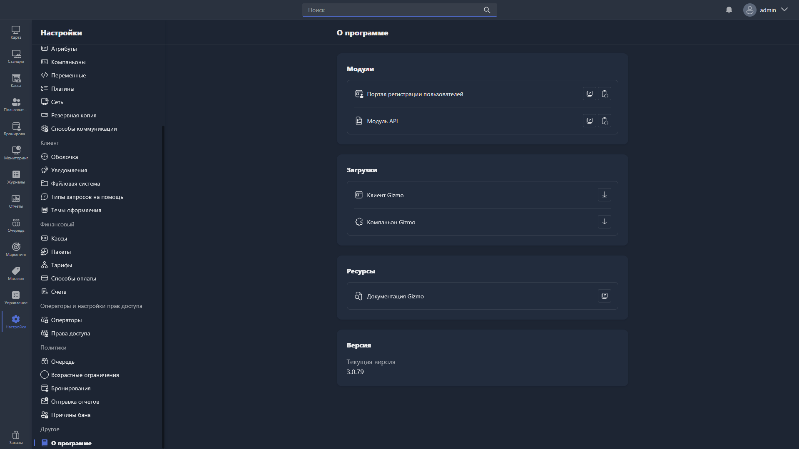

Страница содержит общую информацию о системе Gizmo и ссылки на связанные ресурсы. Открывается в **Настройки -> Другое -> О программе**.

{width=1919px height=1079px}

<note type="hotfixes" title="Перечень определений" collapsed="true">

### Модули

Список дополнительных модулей системы с возможностью перехода к их настройкам или документации:

-  **Портал регистрации пользователей** -- веб-портал для самостоятельной регистрации пользователей.

-  **Модуль API** -- интерфейс для интеграции Gizmo со сторонними системами.

### Загрузки

Ссылки для скачивания компонентов системы:

-  **Клиент Gizmo** -- клиентское приложение, устанавливаемое на хосты.

-  **Компаньон Gizmo** -- приложение Gizmo Companion.

### Ресурсы

-  **Документация Gizmo** -- ссылка на официальную документацию системы.

### Версия

Отображается текущая версия установленного Gizmo Manager.

</note>

<note type="hotfixes" title="Влияние на систему" collapsed="true">

> [!NOTE]
>
> Данный раздел находится в разработке.

</note>

<note type="hotfixes" title="Заключение" collapsed="true">

Страница «О программе» помогает узнать версию Gizmo Manager, перейти к дополнительным модулям, скачать компоненты системы и открыть документацию.

</note>
