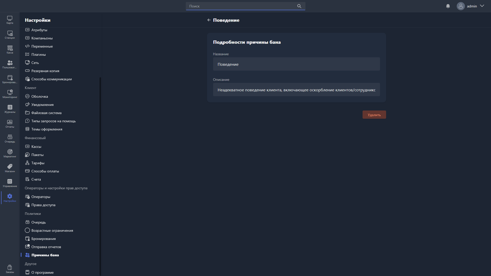

Карточка причины бана открывается при создании новой причины или редактировании существующей.

{width=1919px height=1079px}

<note type="hotfixes" title="Перечень определений" collapsed="true">

### Подробности причины бана

-  **Название** -- название причины бана. Поле обязательно для заполнения.

-  **Описание** -- описание причины бана. Поле обязательно для заполнения.

</note>

<note type="hotfixes" title="Влияние на систему" collapsed="true">

> [!NOTE]
>
> Данный раздел находится в разработке.

</note>

<note type="hotfixes" title="Заключение" collapsed="true">

В карточке задаются название и описание причины бана -- оба поля обязательны.

</note>
