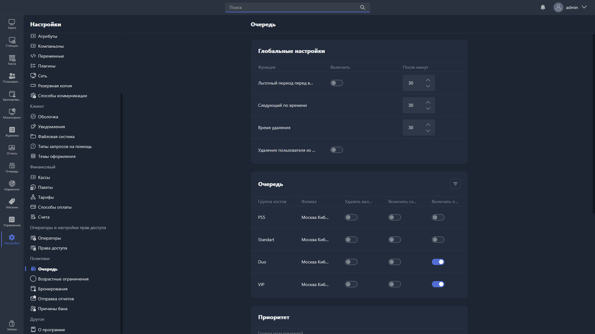

Здесь настраивается поведение очереди ожидания -- системы, позволяющей пользователям занимать место в очереди на хост, когда все компьютеры заняты.

{width=1919px height=1079px}

<note type="hotfixes" title="Перечень определений" collapsed="true">

### Глобальные настройки

Глобальные настройки применяются ко всем группам хостов. Представлены таблицей из трёх столбцов: **Функция**, **Включить** и **После минут**.

-  **Льготный период перед выходом из системы** -- после того как хост стал доступен, пользователь из очереди получает льготный период для входа в систему. Можно включить или выключить, продолжительность задаётся в минутах.

-  **Следующий по времени** -- время в минутах, в течение которого следующий пользователь в очереди получает приоритет на доступный хост.

-  **Время удаления** -- время в минутах, по истечении которого неактивный пользователь автоматически удаляется из очереди.

-  **Удаление пользователя из всех очередей при входе в систему** -- при включении пользователь автоматически удаляется из всех очередей после успешного входа на хост.

### Очередь

Здесь настраиваются параметры очереди для каждой группы хостов.

Таблица содержит столбцы:

-  **Группа хостов** -- группа хостов, для которой применяются настройки.

-  **Филиал** -- филиал, к которому относится группа хостов.

-  **Удалить включенные** -- при включении пользователи автоматически удаляются из очереди этой группы хостов по истечении времени удаления.

-  **Включить следующий в очереди** -- при включении активируется режим «Следующий по времени» для этой группы хостов.

-  **Включить приоритеты** -- при включении для этой группы хостов учитывается приоритет групп пользователей, заданный в блоке «Приоритет».

### Приоритет

Здесь настраивается приоритет групп пользователей в очереди.

Чтобы изменить порядок приоритета, перетащите нужную группу пользователей за иконку перетаскивания <icon code="grip-vertical" /> на требуемую позицию: чем выше группа в списке, тем выше её приоритет.

</note>

<note type="hotfixes" title="Влияние на систему" collapsed="true">

-  Если пользователь из очереди не войдёт в систему за время льготного периода, его переместят в конец очереди или удалят.

-  Группы пользователей с более высоким приоритетом получают место в очереди раньше остальных.

</note>

<note type="hotfixes" title="Заключение" collapsed="true">

Настроенная очередь ожидания распределяет освободившиеся хосты между ожидающими пользователями с учётом заданных правил и приоритетов групп.

</note>
