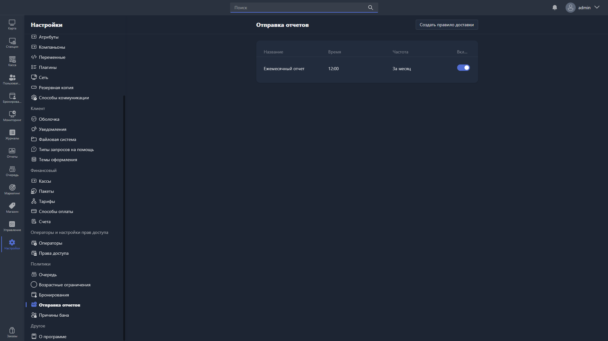

Здесь настраиваются правила автоматической доставки отчётов.

{width=1919px height=1079px}

<note type="hotfixes" title="Перечень определений" collapsed="true">

В таблице отображаются все созданные правила:

-  **Название** -- название правила доставки.

-  **Время** -- время отправки отчётов.

-  **Частота** -- периодичность отправки.

-  **Включено** -- статус правила (активно или отключено).

Чтобы создать новое правило, нажмите <cmd text="Создать правило доставки"/> в правом углу страницы.

Чтобы отредактировать существующее, нажмите на соответствующую строку в таблице -- откроется [карточка правила доставки](./scheduler-card.md).

</note>

<note type="hotfixes" title="Влияние на систему" collapsed="true">

> [!NOTE]
>
> Данный раздел находится в разработке.

</note>

<note type="hotfixes" title="Заключение" collapsed="true">

Правила доставки позволяют автоматически отправлять отчёты в заданное время с нужной периодичностью.

</note>
