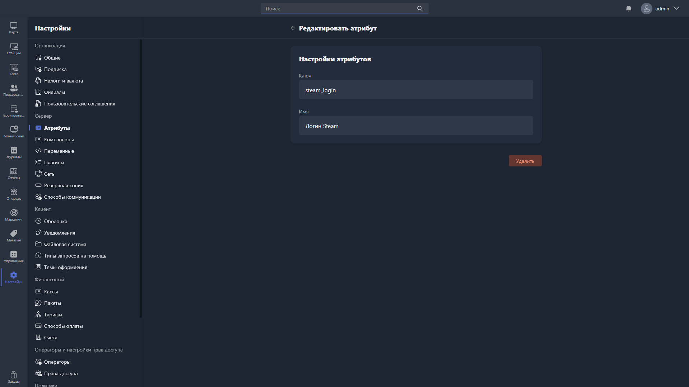

Карточка атрибута открывается, если дважды нажать на атрибут в таблице раздела [«Атрибуты»](./_index.md). В ней атрибут можно отредактировать или удалить.

{width=1919px height=1079px}

<note type="hotfixes" title="Перечень определений" collapsed="true">

В карточке атрибута доступны для заполнения поля:

-  **Ключ** -- уникальный идентификатор атрибута (название в базе данных).

-  **Имя** -- название атрибута для отображения в Gizmo Client и Gizmo Manager.

Чтобы удалить атрибут, нажмите <cmd text="Удалить"/> в правом нижнем углу карточки.

</note>

<note type="hotfixes" title="Влияние на систему" collapsed="true">

> [!CAUTION]
> 
> При удалении атрибута удаляются все связанные с ним значения.

</note>

<note type="hotfixes" title="Заключение" collapsed="true">

В карточке атрибута задаются его ключ и имя, а также выполняется удаление атрибута.

</note>
