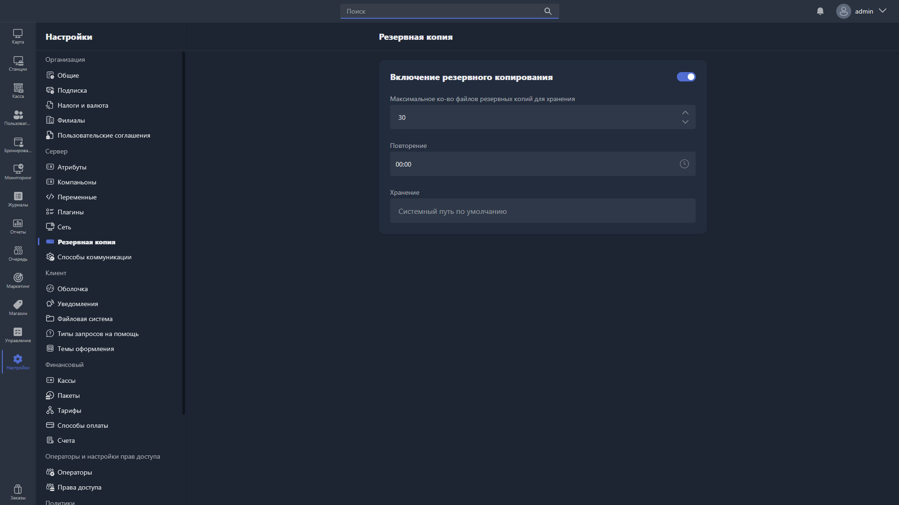

**Резервная копия** -- копия базы данных вашего Gizmo Server. Она нужна для переноса базы данных на другой сервер или для её восстановления.

В этом разделе настраивается автоматическое резервное копирование базы данных Gizmo Server: включение, количество хранимых копий, расписание и место хранения.

{width=1919px height=1079px}

<note type="hotfixes" title="Перечень определений" collapsed="true">

- **Включение резервного копирования** -- переключатель, который включает автоматическое резервное копирование. По умолчанию отключено. После включения становятся доступны остальные параметры, при выключении они становятся неактивными.
- **Максимальное количество файлов резервных копий для хранения** -- целое значение, которое задаёт, сколько резервных копий хранить одновременно. По умолчанию -- 10.
- **Повторение** -- расписание резервного копирования: время, в которое будет создана резервная копия. По умолчанию -- 0:00 (в полночь).
- **Хранение** -- путь в файловой системе, по которому будут сохраняться резервные копии. Указывайте полный путь до нужной папки и учитывайте различия в построении путей между операционными системами.

**Пути по умолчанию**

<table header="row">
<tr>
<td>

Вариант установки

Gizmo Server

</td>
<td colspan="2">

Путь резервных копий по умолчанию

</td>
</tr>
<tr>
<td>

Windows

</td>
<td colspan="2">

`C:\Program Files\NETProjects\Gizmo Server\data\Backup`

</td>
</tr>
<tr>
<td>

Linux

</td>
<td colspan="2">

`/opt/gizmo-service/backup`

</td>
</tr>
<tr>
<td>

Docker

</td>
<td colspan="2">

`/app/mount/backup`

</td>
</tr>
</table>

</note>

<note type="hotfixes" title="Влияние на систему" collapsed="true">

- Пока резервное копирование выключено, Gizmo Server не создаёт копий базы данных.
- После включения Gizmo Server создаёт копию базы данных по расписанию из поля **Повторение** и сохраняет её по пути из поля **Хранение**.
- Когда количество копий превышает лимит, Gizmo Server автоматически удаляет самую старую. Например, если копия создаётся ежедневно, а лимит равен 10, то после создания одиннадцатой копии самая старая будет удалена -- на сервере всегда хранятся только 10 последних копий.

> [!WARNING]
>
> Убедитесь, что пользователь операционной системы, от имени которого запущен Gizmo Server, обладает правами на чтение и запись в указанную папку.

</note>

<note type="hotfixes" title="Заключение" collapsed="true">

Настроенное резервное копирование позволяет в любой момент восстановить базу данных Gizmo Server или перенести её на другой сервер. Чтобы хранить копии вне сервера, воспользуйтесь инструкцией [«Резервное копирование в облако»](./../../../../user-manual/contents/tutorials/operations/cloud-backup.md).

</note>
