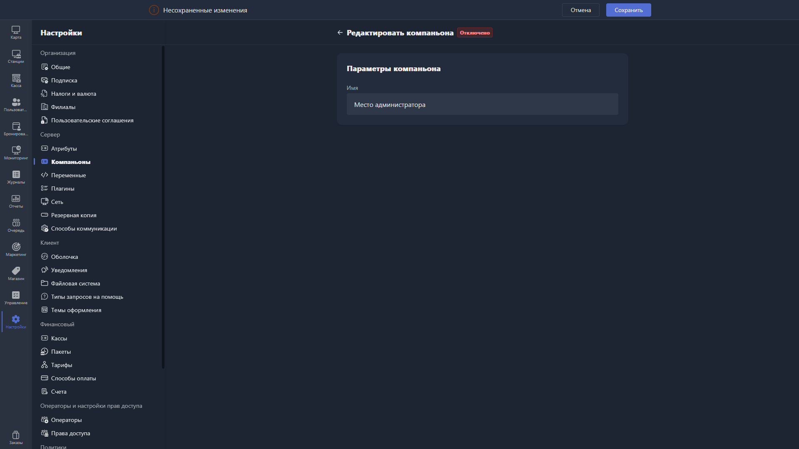

Окно добавления компаньона открывается по кнопке <cmd text="Создать Companion"/> в правом верхнем углу раздела [«Компаньоны»](./_index.md).

{width=1919px height=1079px}

<note type="hotfixes" title="Перечень определений" collapsed="true">

При создании нового компаньона доступно поле:

-  **Имя** -- произвольное название компаньона для отображения в Gizmo Manager.

</note>

<note type="hotfixes" title="Влияние на систему" collapsed="true">

После сохранения компаньон появится в общем списке, а в его карточке будет доступен токен для подключения.

</note>

<note type="hotfixes" title="Заключение" collapsed="true">

При добавлении компаньона задаётся только его имя, а токен для подключения затем доступен в [карточке компаньона](./companion-card.md).

</note>
