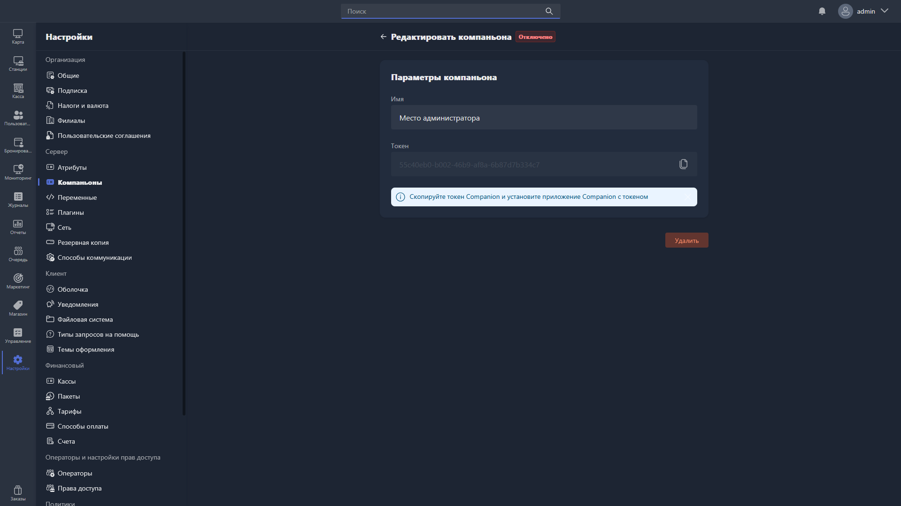

Карточка компаньона открывается, если дважды нажать на компаньона в таблице раздела [«Компаньоны»](./_index.md). В ней можно изменить имя компаньона, скопировать его токен или удалить его.

{width=1919px height=1079px}

<note type="hotfixes" title="Перечень определений" collapsed="true">

В карточке компаньона доступно поле:

-  **Имя** -- произвольное название компаньона для отображения в Gizmo Manager.

Чтобы скопировать токен компаньона, нажмите на иконку копирования в поле «Токен».

Чтобы удалить компаньона, нажмите <cmd text="Удалить"/> в правом нижнем углу карточки.

</note>

<note type="hotfixes" title="Влияние на систему" collapsed="true">

> [!NOTE]
>
> Данный раздел находится в разработке.

</note>

<note type="hotfixes" title="Заключение" collapsed="true">

Карточка компаньона нужна, чтобы переименовать компаньона, получить его токен или удалить компаньона.

</note>
