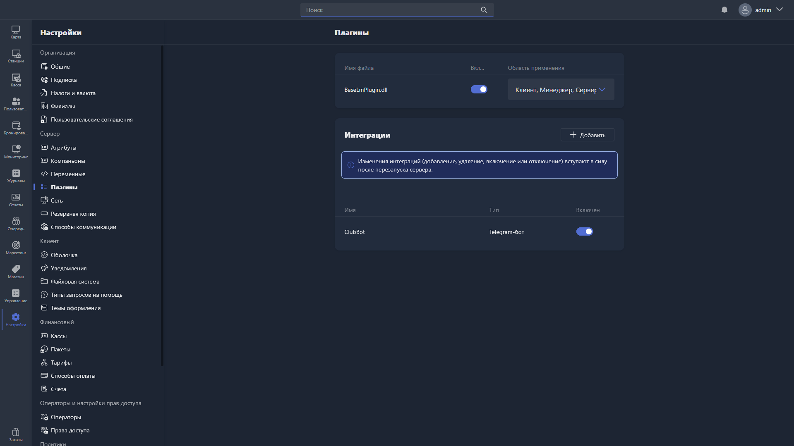

В этом разделе отображаются подключённые сторонние плагины и интеграции.

{width=1919px height=1079px}

<note type="hotfixes" title="Перечень определений" collapsed="true">

-  **Плагины** -- дополнения для Gizmo, которые сторонние разработчики создают на основе открытой документации.

-  **Интеграции** -- подключения к сторонним сервисам.

</note>

<note type="hotfixes" title="Влияние на систему" collapsed="true">

> [!CAUTION]
>
> Изменения интеграций -- добавление, удаление, включение или отключение -- вступают в силу **после перезапуска сервера**. Подробнее -- в статье [«Добавление интеграции»](./add-new-plugin.md).

</note>

<note type="hotfixes" title="Заключение" collapsed="true">

Плагины расширяют возможности Gizmo, а интеграции подключают его к сторонним сервисам.

> [!NOTE]
> 
> Подробнее о разработке и подключении плагинов -- в разделе «Для разработчиков», в группе [«Создание плагинов»](./../../../../../for-developers/sozdanie-plaginov/_index.md).

</note>
