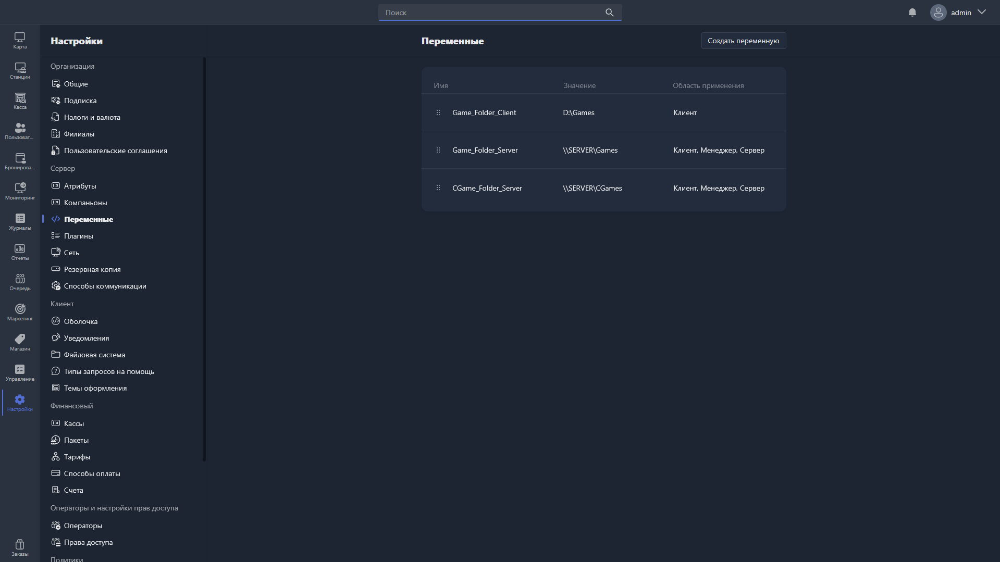

**Переменные** -- статичные переменные окружения, которые могут использовать приложения Gizmo: Gizmo Manager, Gizmo Client и Gizmo Server. Чаще всего переменные используют в скриптах и приложениях -- например, для указания путей до исполняемых файлов. В этом разделе можно посмотреть уже добавленные переменные и создать новые, а также список встроенных переменных Gizmo.

{width=1919px height=1079px}

<note type="hotfixes" title="Перечень определений" collapsed="true">

Формат вызова переменной -- `%var%`, где `var` -- название переменной.

Таблица переменных показывает:

-  **Имя** -- имя переменной, заданное при создании или редактировании.

-  **Значение** -- значение переменной.

-  **Область применения** -- где может быть вызвана переменная (Gizmo Client, Gizmo Manager, Gizmo Server).

Чтобы изменить или удалить переменную, дважды нажмите на неё в таблице -- откроется [карточка переменной](./variable-card.md).

Чтобы добавить новую переменную, нажмите <cmd text="Создать переменную"/> в правом верхнем углу -- поля для заполнения описаны в статье [«Добавление новой переменной»](./add-new-var.md).

### Встроенные переменные

Кроме переменных, созданных вручную, в Gizmo существуют встроенные переменные, которые можно использовать для настроек, скриптов и задач:

<table header="row">
<colgroup><col width="310"/><col width="260"/><col width="260"/></colgroup>
<tr>
<td>

Переменная

</td>
<td colspan="2">

Значение

</td>
</tr>
<tr>
<td>

%HOST_NUMBER%

</td>
<td colspan="2">

Номер устройства

</td>
</tr>
<tr>
<td>

%HOST_NAME%

</td>
<td colspan="2">

Имя устройства в Gizmo Manager

</td>
</tr>
<tr>
<td>

%CUR_HOST_GROUP_NAME%

</td>
<td colspan="2">

Имя группы устройств

</td>
</tr>
<tr>
<td>

%CUR_HOST_GROUP_ID%

</td>
<td colspan="2">

ID группы устройств

</td>
</tr>
<tr>
<td>

%CUR_USER%

</td>
<td colspan="2">

Логин текущего пользователя

</td>
</tr>
<tr>
<td>

%CUR_USER_ID%

</td>
<td colspan="2">

ID текущего пользователя

</td>
</tr>
<tr>
<td>

%CUR_USER_STATE%

</td>
<td colspan="2">

Текущее состояние пользователя

</td>
</tr>
<tr>
<td>

%CUR_USER_TYPE%

</td>
<td colspan="2">

Тип аккаунта пользователя

</td>
</tr>
<tr>
<td>

%CUR_USER_GROUP%

</td>
<td colspan="2">

Текущая группа пользователя

</td>
</tr>
<tr>
<td>

%CUR_APP_PROFILE%

</td>
<td colspan="2">

Текущая группа приложений

</td>
</tr>
<tr>
<td>

%CUR_SEC_PROFILE%

</td>
<td colspan="2">

Текущий профиль безопасности

</td>
</tr>
<tr>
<td>

%USERMINUTESLEFT%

</td>
<td colspan="2">

Количество минут, доступных пользователю

</td>
</tr>
<tr>
<td>

%CUR_WORKING_DIRECTORY%

</td>
<td colspan="2">

Текущая рабочая директория Gizmo Client

</td>
</tr>
<tr>
<td>

%ENTRYTITLE%

</td>
<td colspan="2">

Название приложения

</td>
</tr>
<tr>
<td>

%ENTRYPUBLISHER%

</td>
<td colspan="2">

Наименование издателя приложения

</td>
</tr>
<tr>
<td>

%ENTRYDEVELOPER%

</td>
<td colspan="2">

Наименование разработчика приложения

</td>
</tr>
<tr>
<td>

%CUR_EXE_PATH%

</td>
<td colspan="2">

Текущий путь запуска приложения

</td>
</tr>
<tr>
<td>

%CUR_EXE_ARGUMENTS%

</td>
<td colspan="2">

Текущие аргументы запуска приложения

</td>
</tr>
<tr>
<td>

%CUR_EXE_WORKING_DIRECTORY%

</td>
<td colspan="2">

Текущая рабочая директория приложения

</td>
</tr>
<tr>
<td>

%ENTRYSOURCE%

</td>
<td colspan="2">

Текущая директория приложения (указанная в разделе «Развертывание»)

</td>
</tr>
<tr>
<td>

%ENTRYDESTINATION%

</td>
<td colspan="2">

Целевая директория приложения (указанная в разделе «Развертывание»)

</td>
</tr>
<tr>
<td>

%LICENSE%

</td>
<td colspan="2">

Используемый ключ лицензии для приложения (только для использования в подразделе «Лицензии» для приложений)

</td>
</tr>
<tr>
<td>

%LICENSEKEYUSER%

</td>
<td colspan="2">

Имя пользователя, использующего лицензионный ключ

</td>
</tr>
<tr>
<td>

%LICENSEKEYUSERID%

</td>
<td colspan="2">

ID пользователя, использующего лицензионный ключ

</td>
</tr>
</table>

</note>

<note type="hotfixes" title="Влияние на систему" collapsed="true">

> [!NOTE]
>
> Данный раздел находится в разработке.

</note>

<note type="hotfixes" title="Заключение" collapsed="true">

Переменные позволяют задавать значения, которые затем вызываются в приложениях Gizmo в формате `%var%`.

Встроенные переменные позволяют подставлять в настройки, скрипты и задачи данные об устройстве, пользователе и приложении.

</note>
