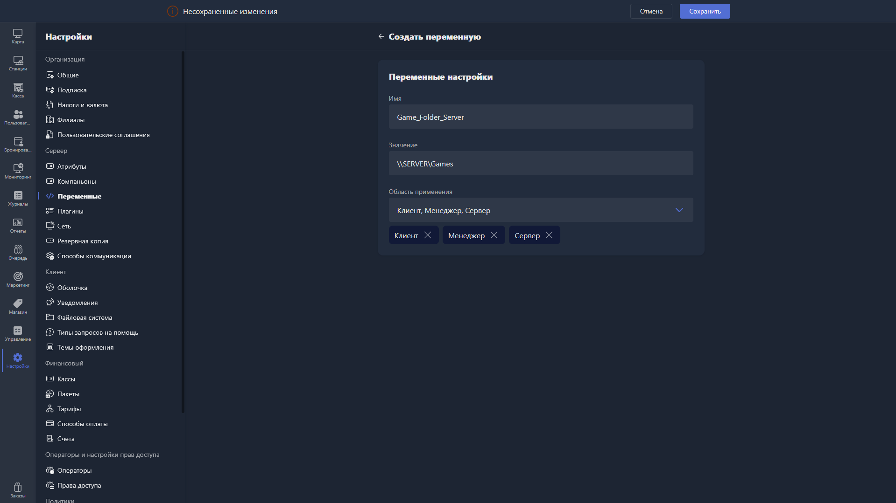

Окно добавления переменной открывается по кнопке <cmd text="Создать переменную"/> в правом верхнем углу раздела [«Переменные»](./_index.md).

{width=1919px height=1079px}

<note type="hotfixes" title="Перечень определений" collapsed="true">

При создании новой переменной доступны поля:

-  **Имя** -- название переменной, указывается без экранирующих символов `%`.

-  **Значение** -- значение новой переменной.

-  **Область применения** -- область, в которой может быть вызвана переменная.

</note>

<note type="hotfixes" title="Влияние на систему" collapsed="true">

> [!NOTE]
>
> Данный раздел находится в разработке.

</note>

<note type="hotfixes" title="Заключение" collapsed="true">

При добавлении переменной задаются её имя, значение и область применения.

</note>
