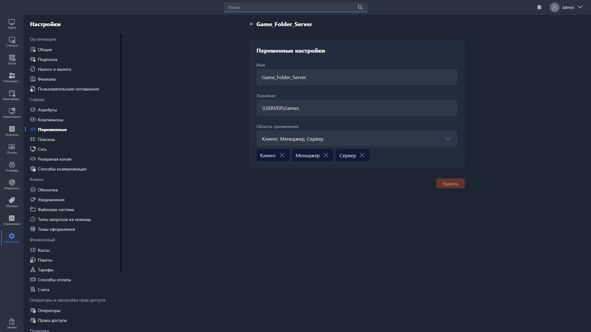

Карточка переменной открывается, если дважды нажать на переменную в таблице раздела [«Переменные»](./_index.md). В ней переменную можно изменить или удалить.

{width=1919px height=1079px}

<note type="hotfixes" title="Перечень определений" collapsed="true">

В карточке переменной доступны для заполнения поля:

-  **Имя** -- название переменной, указывается без экранирующих символов `%`.

-  **Значение** -- значение переменной.

-  **Область применения** -- область, в которой может быть вызвана переменная.

Чтобы удалить переменную, нажмите <cmd text="Удалить"/> в правом нижнем углу карточки.

</note>

<note type="hotfixes" title="Влияние на систему" collapsed="true">

> [!NOTE]
>
> Данный раздел находится в разработке.

</note>

<note type="hotfixes" title="Заключение" collapsed="true">

В карточке переменной редактируются её имя, значение и область применения, а также выполняется удаление переменной.

</note>
