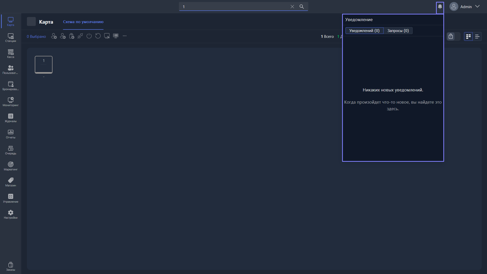

Уведомления открываются в правом верхнем углу экрана приложения, слева от логина аккаунта администратора. Уведомляют администратора о запросах помощи от клиентов, заказах, обновлениях и других событиях.

{width=1919px height=1079px}

<note type="hotfixes" title="Перечень определений" collapsed="true">

Доступны два раздела окна уведомлений:

-  **Уведомления** (количество) -- уведомления о заказах, обновлениях и других событиях.

-  **Запросы** (количество) -- запросы помощи от клиентов.

</note>

<note type="hotfixes" title="Влияние на систему" collapsed="true">

> [!NOTE]
>
> Данный раздел находится в разработке.

</note>

<note type="hotfixes" title="Заключение" collapsed="true">

Уведомления позволяют администратору видеть новые заказы, запросы помощи от клиентов и другие события в момент их появления.

</note>
