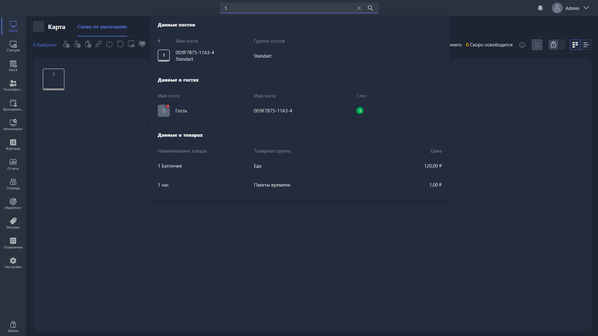

Инструмент поиска располагается в верхней части интерфейса страницы и позволяет найти клиентов, игровые места, товары и пакеты времени.

{width=1919px height=1079px}

<note type="hotfixes" title="Перечень определений" collapsed="true">

Для поиска доступны следующие разделы:

-  Клиенты

-  Игровые места

-  Товары

-  Пакеты времени

### Доступные кнопки

#### Для игровых мест

-  **Вход в систему** -- позволяет войти в выбранный аккаунт пользователя на этом устройстве.

-  **Включить режим администратора** -- включает режим администратора (полный доступ) на этом устройстве.

#### Для пользователей

-  **Вход в систему** -- позволяет войти в выбранный аккаунт пользователя на выбранном устройстве.

-  **Закрыть баланс** -- деавторизует клиента на игровом месте и позволяет закрыть сессию и (или) активный счёт.

-  **Депозит** -- позволяет пополнить депозит выбранного клиента.

-  **Продажи** -- открывает раздел продаж с выбранным пользователем.

#### Для товаров и пакетов времени

Нажатие на пункт товара или пакета времени открывает карточку его настроек.

</note>

<note type="hotfixes" title="Влияние на систему" collapsed="true">

> [!NOTE]
>
> Данный раздел находится в разработке.

</note>

<note type="hotfixes" title="Заключение" collapsed="true">

Поиск позволяет быстро найти клиента, игровое место, товар или пакет времени и сразу выполнить действие из результатов поиска.

</note>
