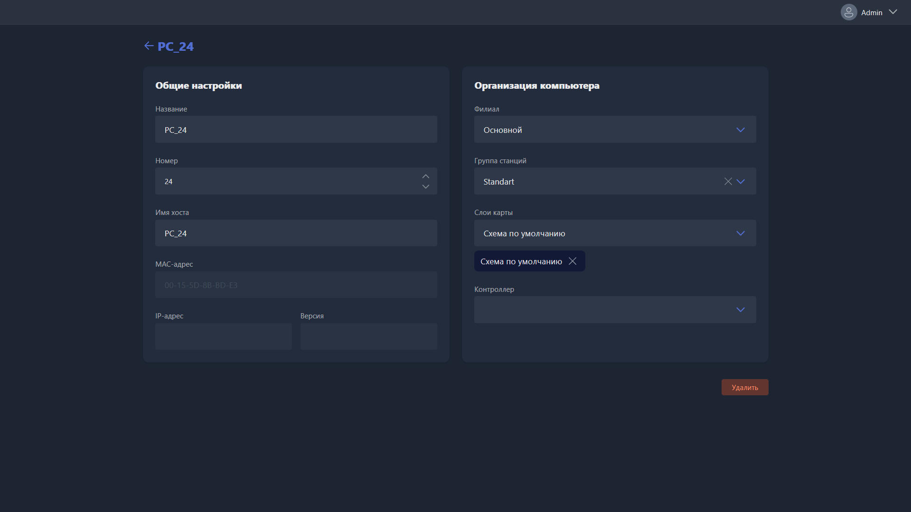

Карточка открывается при ручном создании нового ПК или редактировании существующего.

{width=1919px height=1079px}

<note type="hotfixes" title="Перечень определений" collapsed="true">

-  **Название** -- имя ПК, отображается в списке станций, на карте клуба и в результатах поиска.

-  **Номер** -- порядковый номер ПК в Gizmo.

-  **Имя хоста** -- имя ПК в системе Windows.

-  **MAC адрес** -- физический адрес сетевой карты ПК. Используется для опознавания устройства при смене IP и для отправки Wake On LAN.

-  **IP адрес** -- текущий адрес ПК в локальной сети. Отображается, только если ПК включён и подключён к серверу.

-  **Версия** -- версия Gizmo Client на этом ПК. Отображается только при активном подключении.

-  **Филиал** -- филиал, в котором отображается этот ПК.

-  **Группа станций** -- группа, к которой привязан этот ПК.

-  **Слои карты** -- слои, на которых ПК отображается в разделе <cmd text="Карта"/>.

-  **Контроллер** -- контроллер, привязанный к ПК.

</note>

<note type="hotfixes" title="Влияние на систему" collapsed="true">

-  Если в <cmd text="Настройки"/> -> <cmd text="Сервер"/> -> <cmd text="Сеть"/>, в блоке **Правила подключения**, включена функция **Восстановление имени хоста**, Gizmo назначает **Имя хоста** для ПК в Windows при каждом подключении.

-  **Группа станций** определяет стоимость почасовой оплаты, доступные пакеты времени и применяемый профиль безопасности.

-  **Контроллер** требуется для удалённого включения и выключения HDMI-сигнала на этом месте.

</note>

<note type="hotfixes" title="Заключение" collapsed="true">

Карточка задаёт, под каким именем и номером ПК виден в Gizmo, к какому филиалу, группе и слоям карты он относится и какой контроллер к нему привязан.

</note>
