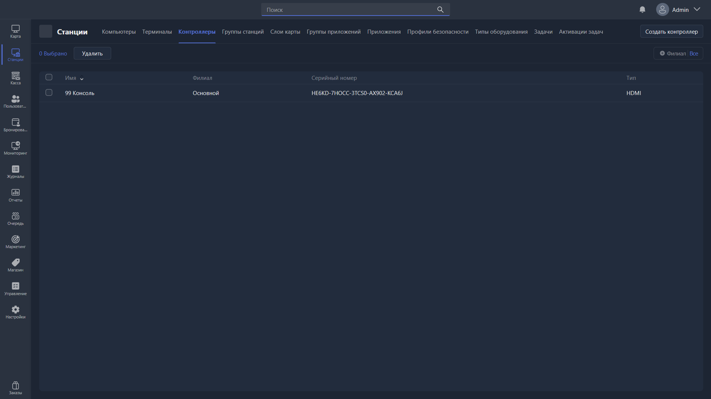

Раздел отвечает за создание и редактирование контроллеров Gizmo -- это устройства, которые позволяют удалённо включать и выключать HDMI-сигнал на экране. Чаще всего используются для экранов консолей, чтобы контролировать время.

{width=1919px height=1079px}

<note type="hotfixes" title="Перечень определений" collapsed="true">

### Список контроллеров

-  **Имя** -- название контроллера в Gizmo.

-  **Филиал** -- филиал, к которому привязан контроллер.

-  **Серийный номер** -- номер, указанный на корпусе устройства.

-  **Тип** -- тип контроллера.

### Действия

-  **Редактировать** -- открывает [карточку редактирования](./controller-card.md) выбранного контроллера.

-  **Удалить** -- удаляет выбранные контроллеры.

-  **Создать контроллер** -- создаёт карточку нового контроллера.

</note>

<note type="hotfixes" title="Влияние на систему" collapsed="true">

> [!NOTE]
>
> Данный раздел находится в разработке.

</note>

<note type="hotfixes" title="Заключение" collapsed="true">

Раздел позволяет завести в Gizmo контроллеры клуба, чтобы затем привязать их к игровым местам, где нужен контроль HDMI-сигнала.

</note>
