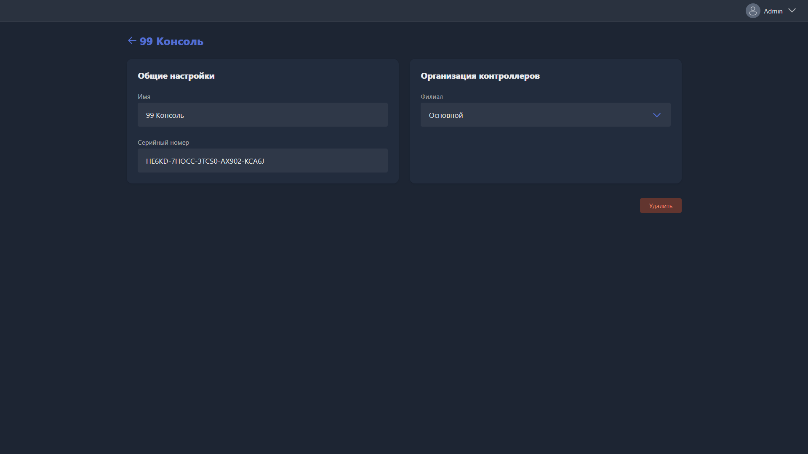

Карточка открывается при создании нового контроллера или редактировании существующего.

{width=1919px height=1079px}

<note type="hotfixes" title="Перечень определений" collapsed="true">

-  **Имя** -- название контроллера в Gizmo.

-  **Серийный номер** -- номер, указанный на корпусе устройства. Используется, чтобы сопоставить запись в системе с физическим контроллером.

-  **Филиал** -- филиал, к которому привязан контроллер.

</note>

<note type="hotfixes" title="Влияние на систему" collapsed="true">

> [!NOTE]
>
> Данный раздел находится в разработке.

</note>

<note type="hotfixes" title="Заключение" collapsed="true">

Карточка связывает физический контроллер с записью в Gizmo и филиалом, к которому он относится.

</note>
