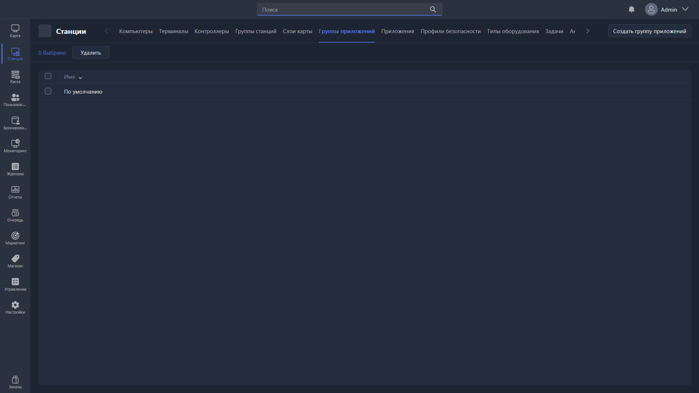

Группа приложений объединяет несколько приложений в один набор, который можно назначить группе станций -- вместо того чтобы привязывать каждое приложение к каждой станции отдельно.

{width=1919px height=1079px}

<note type="hotfixes" title="Перечень определений" collapsed="true">

### Список групп

-  **Имя** -- название группы приложений.

### Действия

-  **Редактировать** -- открывает [карточку редактирования](./kartochka-redaktirovaniya-gruppy-prilozheniya.md) выбранной группы.

-  **Удалить** -- удаляет выбранные группы приложений.

-  **Создать группу приложений** -- создаёт группу и открывает карточку её редактирования.

</note>

<note type="hotfixes" title="Влияние на систему" collapsed="true">

-  Приложения группы становятся доступны на станциях той группы станций, которой назначена группа приложений.

-  Если приложение из группы отсутствует по указанному пути на конкретном ПК, оно не отображается в оболочке этого ПК.

</note>

<note type="hotfixes" title="Заключение" collapsed="true">

Группа приложений позволяет управлять набором программ на станциях целиком. Готовая группа назначается станциям в [карточке группы станций](./../station-groups/station-group-card.md), поле **Группа приложений**.

</note>
