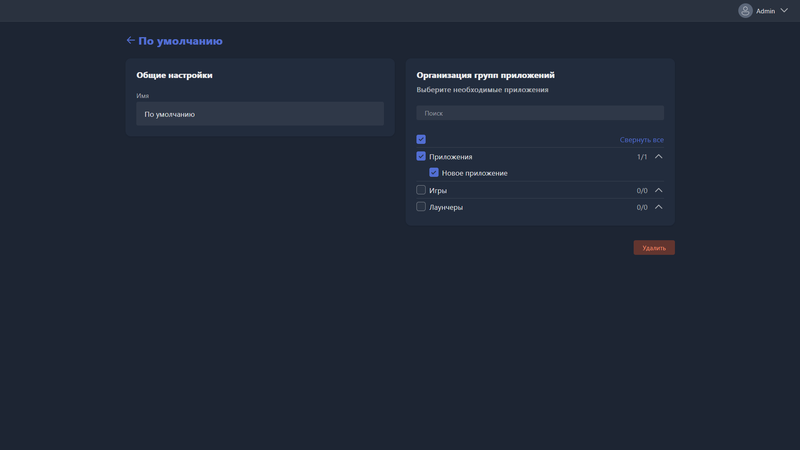

Карточка открывается при создании новой группы приложений или редактировании существующей.

{width=1919px height=1079px}

<note type="hotfixes" title="Перечень определений" collapsed="true">

-  **Имя** -- название группы приложений.

-  **Организация групп приложений** -- вкладка с выбором приложений, которые входят в группу. Отметьте нужные приложения галочкой или найдите их через поиск.

</note>

<note type="hotfixes" title="Влияние на систему" collapsed="true">

> [!NOTE]
>
> Данный раздел находится в разработке.

</note>

<note type="hotfixes" title="Заключение" collapsed="true">

Карточка задаёт название группы приложений и состав входящих в неё приложений.

</note>
