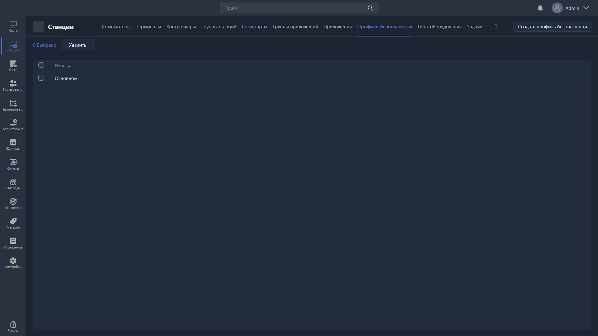

Раздел отвечает за создание профилей безопасности, используемых для ограничений на клиентских ПК, и управление ими. Профили безопасности могут блокировать функции системы так, чтобы клиент не имел никакого доступа на ПК, кроме оболочки и игр в ней, а также не мог снять оболочку.

{width=1919px height=1079px}

<note type="hotfixes" title="Перечень определений" collapsed="true">

### Список профилей

-  **Имя** -- название профиля безопасности.

### Действия

-  **Удалить** -- удаляет выбранные профили безопасности.

-  **Создать профиль безопасности** -- создаёт карточку профиля и открывает её для редактирования.

</note>

<note type="hotfixes" title="Влияние на систему" collapsed="true">

-  Профиль безопасности, выбранный в [карточке группы станций](./../station-groups/station-group-card.md), применяется ко всем ПК и терминалам этой группы.

</note>

<note type="hotfixes" title="Заключение" collapsed="true">

Готовый профиль назначается станциям в [карточке группы станций](./../station-groups/station-group-card.md), поле **Профиль безопасности**. Полный перечень ограничений разобран в статье [«Карточка профиля безопасности»](./kartochka-redaktirovaniya-profilya-bezopasnosti.md).

</note>
