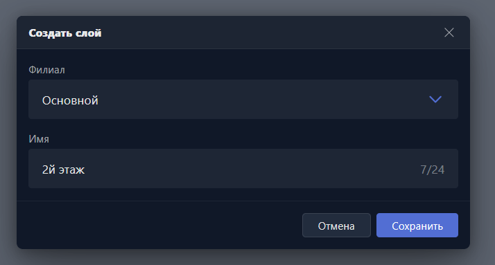

Карточка открывается при создании нового слоя карты или редактировании существующего.

{width=714px height=383px}

<note type="hotfixes" title="Перечень определений" collapsed="true">

-  **Филиал** -- филиал, в котором будет доступен слой.

-  **Имя** -- название слоя в списке слоёв и в разделе <cmd text="Карта"/>.

</note>

<note type="hotfixes" title="Влияние на систему" collapsed="true">

> [!NOTE]
>
> Данный раздел находится в разработке.

</note>

<note type="hotfixes" title="Заключение" collapsed="true">

Карточка задаёт название слоя и филиал, в котором он будет доступен.

</note>
