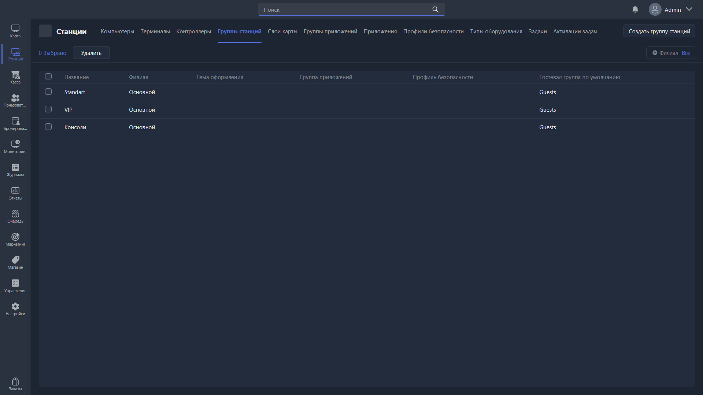

Раздел отвечает за создание групп станций и управление ими. Это группы игровых мест, к которым можно привязывать тарифы (почасовую оплату), пакеты времени, профили безопасности и другие параметры.

{width=1919px height=1079px}

<note type="hotfixes" title="Перечень определений" collapsed="true">

### Список групп

-  **Название** -- имя группы станций.

-  **Филиал** -- филиал, к которому привязана группа.

-  **Тема оформления** -- тема клиентской оболочки для станций группы.

-  **Группа приложений** -- набор приложений, доступных на станциях группы.

-  **Профиль безопасности** -- профиль, применяемый к станциям группы.

-  **Гостевая группа по умолчанию** -- группа пользователей для гостевых учётных записей.

### Действия

-  **Редактировать** -- открывает [карточку редактирования](./station-group-card.md) выбранной группы.

-  **Удалить** -- удаляет выбранные группы станций.

-  **Создать группу станций** -- создаёт новую группу и открывает карточку её редактирования.

</note>

<note type="hotfixes" title="Влияние на систему" collapsed="true">

-  Группа станций, к которой привязан ПК или терминал, определяет стоимость почасовой оплаты, доступные пакеты времени и применяемый профиль безопасности.

-  Если приложение из группы приложений отсутствует по указанному пути на конкретном ПК, оно не отображается в оболочке этого ПК.

Подробнее -- в статье [«Карточка редактирования группы станций»](./station-group-card.md).

</note>

<note type="hotfixes" title="Заключение" collapsed="true">

Группы станций позволяют задавать тарифы, оформление, набор приложений и ограничения сразу для нескольких игровых мест.

</note>
