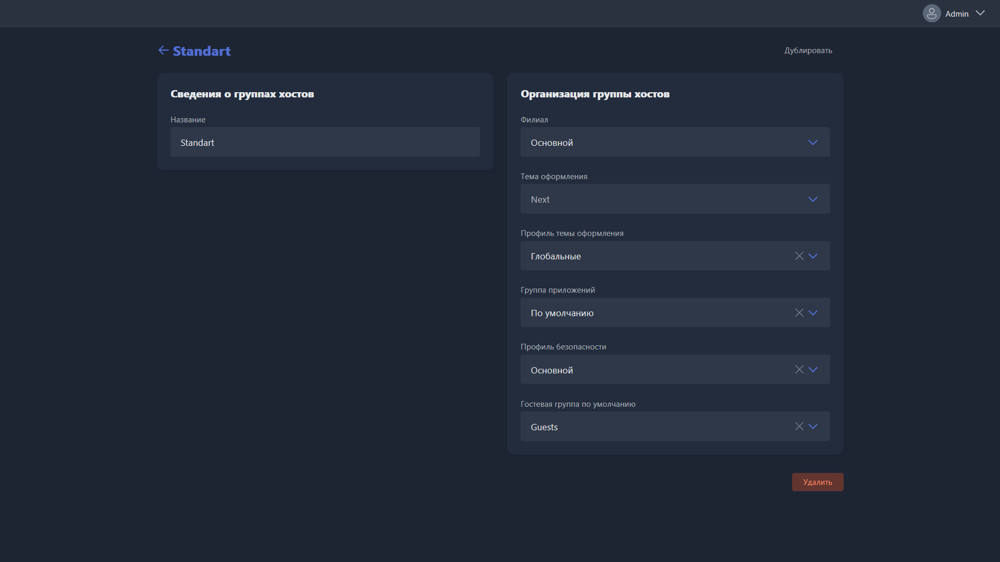

Карточка открывается при создании новой группы станций или редактировании существующей.

{width=1919px height=1079px}

<note type="hotfixes" title="Перечень определений" collapsed="true">

-  **Название** -- имя группы станций.

-  **Филиал** -- филиал, к которому привязана группа станций.

-  **Тема оформления** -- глобальная тема (скин) клиентской оболочки для станций этой группы.

-  **Профиль темы оформления** -- конкретный профиль внутри выбранной темы. Позволяет по-разному оформить оболочку для разных групп станций.

-  **Группа приложений** -- приложения, доступные на станциях этой группы.

-  **Профиль безопасности** -- профиль, применяемый ко всем ПК и терминалам этой группы.

-  **Гостевая группа по умолчанию** -- группа пользователей, в которую попадают одноразовые (гостевые) учётные записи при входе на станциях этой группы.

</note>

<note type="hotfixes" title="Влияние на систему" collapsed="true">

-  Если приложение из **Группы приложений** отсутствует по указанному пути на конкретном ПК, оно не отображается в оболочке этого ПК.

</note>

<note type="hotfixes" title="Заключение" collapsed="true">

Карточка задаёт оформление, набор приложений, ограничения и гостевую группу для всех станций группы.

</note>
