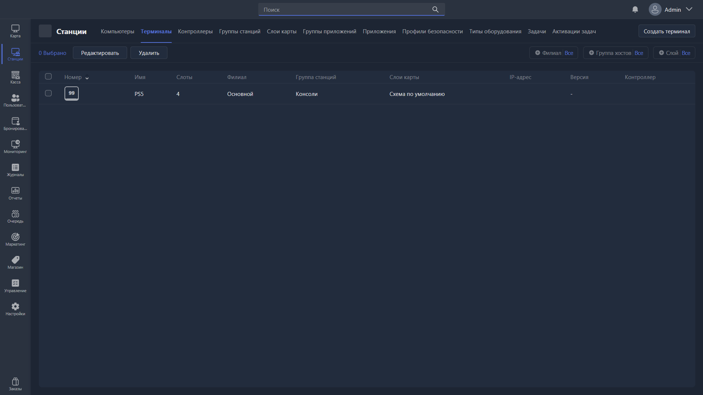

Раздел позволяет добавлять терминалы и управлять ими. Терминалы -- это игровые места в Gizmo, которые не могут быть подключены напрямую технически, но требуют проводить через них продажи для удобного контроля. Например, игровые консоли или бильярдные столы.

Устройства здесь не могут добавляться автоматически, их нужно создавать вручную.

{width=1919px height=1079px}

<note type="hotfixes" title="Перечень определений" collapsed="true">

### Действия

-  **Редактировать** -- открывает [карточку редактирования](./terminal-card.md) выбранного терминала.

-  **Удалить** -- удаляет выбранные терминалы.

-  **Создать терминал** -- создаёт новый терминал.

</note>

<note type="hotfixes" title="Влияние на систему" collapsed="true">

-  **Группа станций**, в которую входит терминал, определяет стоимость почасовой оплаты, доступные пакеты времени и применяемый профиль безопасности.

-  **Контроллер**, привязанный к терминалу, требуется для удалённого включения и выключения HDMI-сигнала на этом месте.

Подробнее -- в статье [«Карточка редактирования терминала»](./terminal-card.md).

</note>

<note type="hotfixes" title="Заключение" collapsed="true">

Раздел позволяет вести учёт времени и продаж по игровым местам, которыми Gizmo не управляет напрямую.

</note>
