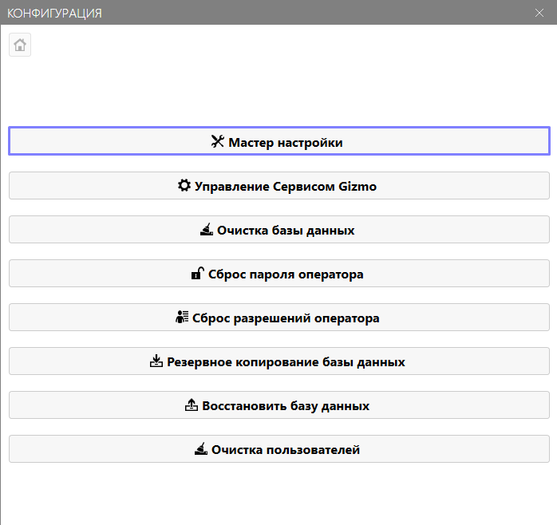
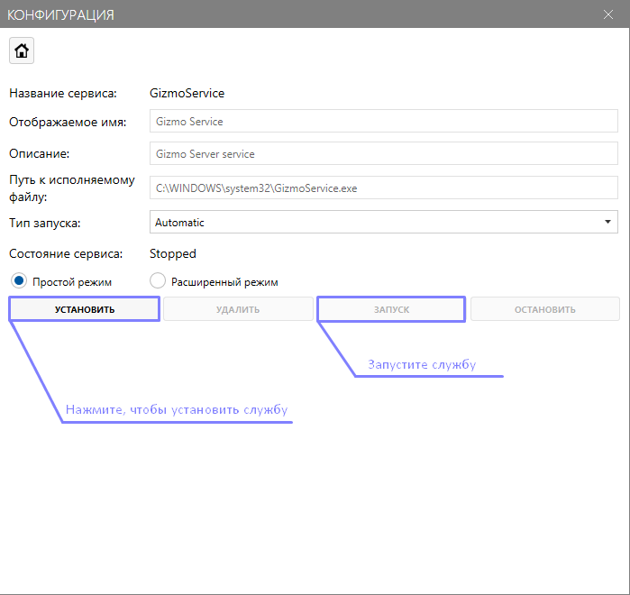
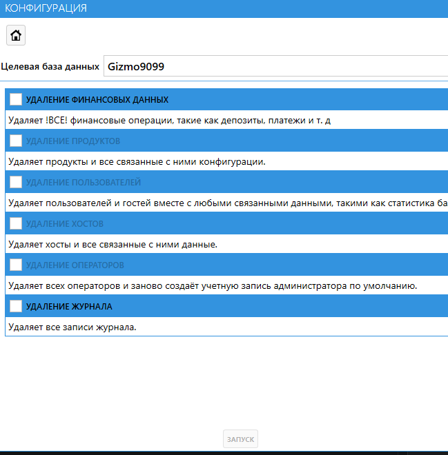

Мастер настройки связывает установленный Gizmo Server с базой данных и с вашим аккаунтом на сайте Gizmo. Его нужно пройти один раз после установки сервера -- и повторно при переносе сервера на другой пк.

Перед запуском мастера установите СУБД -- см. раздел [«Базы данных»](./../../databases/_index.md).

## Как запустить мастер

1. Откройте приложение **ConfigurationTool** -- ярлыком на рабочем столе или из папки `C:\Program Files\NETProjects\Gizmo Server\tools\configuration`.
2. Нажмите <cmd text="Мастер настройки" /> -> <cmd text="Далее" />.

{width=698px height=658px}

## Шаг 1. Параметры базы данных

На странице **Параметры базы данных** указываются подключение к СУБД и имя базы Gizmo. Если вы ставите Gizmo впервые и устанавливали СУБД по инструкции, параметры по умолчанию менять не нужно -- нажмите <cmd text="Далее" />.

> [!IMPORTANT]
>
> Не создавайте базу данных вручную: Gizmo создаст её сам. Если вы переносите сервер с другого пк и уже восстановили базу из резервной копии, укажите имя этой базы -- тогда Gizmo продолжит работу с существующими данными. Подробнее -- в инструкции [«Как перенести Gizmo на другой сервер»](./../../../../../tutorials/operations/server-migration.md).

## Шаг 2. Аккаунт Gizmo

Введите логин и пароль, которые использовали при регистрации на [сайте Gizmo](https://gizmopowered.ru/), и нажмите <cmd text="Далее" />. По этому аккаунту сервер активирует подписку. Если аккаунта ещё нет, зарегистрируйтесь на сайте.

Логин и пароль можно изменить позже в Gizmo Manager -- см. статью [«Подписка»](./../../../../../configure/organization/subscription.md).

## Шаг 3. Установите службу

После мастера установите Gizmo Server как службу Windows: в ConfigurationTool перейдите в раздел **«Управление Сервисом Gizmo»**, установите службу и запустите её. Так сервер будет работать в фоне и запускаться вместе с Windows.

{width=699px height=660px}

> [!TIP]
>
> Если Windows запрашивает учётные данные для управления службой, включите **Расширенный режим** и укажите логин и пароль, с которыми входите в Windows. Если пароля для входа в систему нет, создайте его.

Чем служба отличается от консольного режима -- в статье [«Режимы работы сервера»](./../../../../../usage/gizmo-server/run-modes.md).

## Другие инструменты ConfigurationTool

Кроме мастера настройки и управления службой, в главном меню ConfigurationTool есть инструменты для обслуживания и экстренных случаев:

- **Очистка базы данных** -- удаление данных из базы Gizmo, например чтобы начать работу с чистой базой после тестов (подробнее -- ниже).
- **Сброс пароля оператора** -- если пароль от Gizmo Manager забыл единственный администратор и войти больше некому. После сброса пароль -- `admin`; сразу смените его в Gizmo Manager.
- **Сброс разрешений оператора** -- возвращает разрешения оператора к исходным, если администратор потерял доступ к настройкам.
- **Резервное копирование базы данных** и **Восстановить базу данных** -- ручная копия базы и восстановление из неё. Работают, только если Microsoft SQL Server установлен на том же пк, что и Gizmo Server; подробнее -- в статье [«Резервная копия»](./../../../../../configure/server/backup.md).
- **Очистка пользователей** -- удаление пользователей из базы.

**Очистка базы данных**

{width=649px height=660px}

1. В поле **Целевая база данных** проверьте имя базы, которую нужно очистить.
2. Отметьте, что удалить:
   - **Удаление финансовых данных** -- все финансовые операции: депозиты, платежи и т. д.;
   - **Удаление продуктов** -- товары и все связанные с ними настройки;
   - **Удаление пользователей** -- пользователи и гости вместе со всеми связанными данными, в том числе статистикой;
   - **Удаление хостов** -- хосты (игровые места) и все связанные с ними данные;
   - **Удаление операторов** -- все операторы; после очистки заново создаётся учётная запись администратора по умолчанию;
   - **Удаление журнала** -- все записи журнала.
3. Нажмите **Запуск**.

> [!CAUTION]
>
> Перед очисткой базы обязательно сделайте резервную копию -- см. статью [«Резервная копия»](./../../../../../configure/server/backup.md). Удалённые данные без копии не восстановить.

## Что дальше

Сервер готов. Перейдите к настройке клуба в Gizmo Manager -- по шагам в инструкции [«Быстрый старт»](./../../../../quick-install.md).
